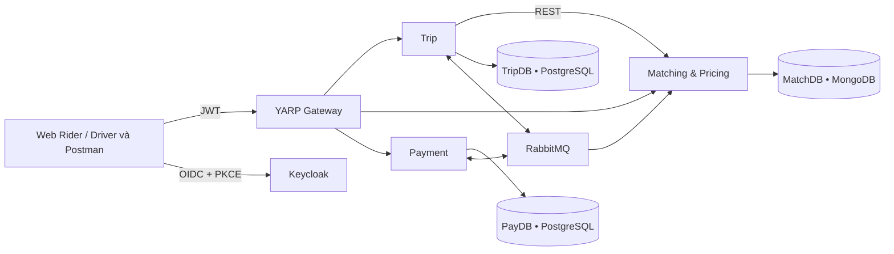
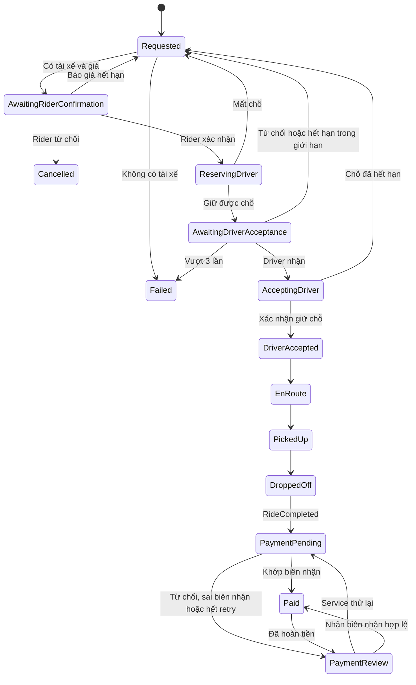

# SwiftRide

Ứng dụng đặt xe SwiftRide gồm giao diện web Rider/Driver và backend .NET 10. Postman gọi YARP tại `http://localhost:8080`. Trip và Payment dùng hai database PostgreSQL và hai tài khoản riêng. Matching & Pricing dùng MongoDB. RabbitMQ chuyển sự kiện giữa các service bằng MassTransit.

## Khởi động

Cần Docker Compose v2, Python 3 và Make trên Linux. Keycloak dùng `http://localhost:8180` trên máy chạy trình duyệt hoặc Postman. Các cổng công khai chỉ lắng nghe trên loopback IPv6 (`::1`), nên máy chạy Docker cần bật IPv6 cho localhost.

```sh
make build
make up
curl -fsS http://localhost:8080/health/ready
```

Nếu nâng cấp từ phiên bản dùng địa chỉ IP và đang giữ volume Keycloak cũ, chạy `python3 scripts/migrate-localhost.py` một lần để đổi callback đã lưu, rồi đăng nhập lại. Với Postman, import lại environment và lấy token mới.

Trên Windows PowerShell:

```powershell
.\scripts\manage.ps1 setup
.\scripts\manage.ps1 build
.\scripts\manage.ps1 up
```

Project Compose `swiftride-pdf` tạo volume riêng cho PostgreSQL, MongoDB, RabbitMQ và Keycloak. Build chạy tuần tự. `make stop` dừng container và giữ dữ liệu. Cần có cổng trống 8080, 8180, 8976 và 15672 trên máy chạy Docker.

## Chạy thử bằng trình duyệt

Mở **http://localhost:8976** sau `make build` và `make up`. Đăng nhập `rider1` bằng `RIDER_PASSWORD` trong .env. Mở cửa sổ riêng tư và đăng nhập `driver1` bằng `DRIVER_PASSWORD`. Cả hai dùng Keycloak với PKCE S256. Web dùng callback loopback đã đăng ký của public client và giữ access token trong cookie phiên mã hóa, HttpOnly.

1. Rider bấm **Bạn muốn đi đâu?**, chọn Nhà hát Thành phố làm điểm đón, chọn điểm đến và Ví hoặc Thẻ. Gõ tên hoặc địa chỉ rồi chọn kết quả, nhập cặp vĩ độ, kinh độ hoặc chọn trực tiếp trên bản đồ Leaflet. Bản đồ tải nền từ OpenStreetMap, tìm địa chỉ qua Photon và lấy tuyến đường tham khảo từ OSRM qua Internet. Khi mất kết nối, các địa điểm mẫu và tọa độ thủ công vẫn dùng được. Bấm **Đặt chuyến**, chờ báo giá rồi **Xác nhận giá**.
2. Driver mở chuyến vừa được mời. Bấm **Nhận chuyến**, **Đang đến đón**, **Đã đón khách** rồi **Đã trả khách**. Driver có thể từ chối để hệ thống tìm người khác.
3. Rider theo dõi trạng thái, diễn biến và biên nhận trên cùng màn hình. Hai giao diện tự cập nhật. Khi cần đăng nhập tài khoản khác, mở menu tài khoản rồi chọn **Đăng xuất**.

Để mở cùng giao diện trên điện thoại Android qua USB, chuyển tiếp hai cổng bằng `adb reverse tcp:8976 tcp:8976` và `adb reverse tcp:8180 tcp:8180`. Sau đó mở cùng địa chỉ web trên điện thoại.

## Kiến trúc và vòng đời



TripDB và PayDB dùng chung tiến trình PostgreSQL để giảm RAM. Mỗi service sở hữu database và tài khoản riêng. Trip hỏi Matching qua REST để lấy kết quả ngay. Sau trả khách, Trip và Payment dùng Outbox cùng RabbitMQ để tiếp tục xử lý khi broker hoạt động trở lại.



Rider còn có thể hủy ở Requested, AwaitingDriverAcceptance, DriverAccepted hoặc EnRoute. Các bước Matching hết lượt retry chuyển chuyến sang Failed. Backend kiểm tra trạng thái, chủ chuyến và phiên bản ở mỗi lệnh.

## Hai chuyến qua Postman

1. Import hai file JSON trong [postman](postman) và chọn environment **SwiftRide local**.
2. Trong Authorization của collection, chọn OAuth 2.0, **Authorization Code (With PKCE)**, S256. Client công khai là `swiftride-postman`, scope `openid`, callback `https://oauth.pstmn.io/v1/callback`. Auth URL và Access Token URL dùng `{{issuer}}/protocol/openid-connect/auth` và `{{issuer}}/protocol/openid-connect/token`. Nếu dùng trình duyệt ngoài, callback `https://oauth.pstmn.io/v1/browser-callback` cũng đã đăng ký.
3. Lấy access token cho `rider1` bằng `RIDER_PASSWORD` trong `.env`. Lưu vào giá trị local của `riderToken`. Đăng xuất khỏi phiên Keycloak hoặc xóa cookie trước khi lấy token cho `driver1` bằng `DRIVER_PASSWORD`. Lưu token đó vào `driverToken`. Các request dùng hai biến này để chuyển vai.
4. Chạy cả collection bằng Collection Runner. Với dữ liệu seed, `driver1` đứng ngay điểm đón. Hai thư mục Card và Wallet tự đợi báo giá, xác nhận, nhận chuyến, cập nhật hành trình và kiểm tra trạng thái `Paid`, giao dịch, sổ cái và số dư. Khi thử thủ công với điểm đón khác, dùng token của tài xế được mời. Bốn tài xế seed có username `driver1` đến `driver4`, số ở cuối `driverId` trùng số thứ tự tài xế.
5. Sao chép header `CorrelationId` của request đặt xe. Trên Linux, dùng `docker compose logs gateway trip matching payment | rg -F '<CorrelationId>'`. Trên Windows dùng `Select-String -SimpleMatch '<CorrelationId>'` sau dấu pipe. `make logs` theo dõi log mới. `make observe` bật OpenTelemetry và Grafana tại `http://localhost:3001` (admin, `GRAFANA_PASSWORD`). PowerShell hỗ trợ cùng lệnh `observe`, `logs`, `stop`.

## Hợp đồng API

| API qua Gateway | Vai trò và dữ liệu |
|---|---|
| `POST /trips` | Rider. Header `Idempotency-Key`, JSON gồm `pickup`, `destination`, `method` và `paymentToken` cho Card. Điểm gồm `latitude`, `longitude`, `label`. |
| `GET /trips/{id}`, `GET /trips` | Chủ chuyến hoặc Driver được mời. Trả trạng thái, phiên bản, báo giá, tài xế và lịch sử. |
| `POST /trips/{id}/confirm-quote`, `cancel` | Rider gửi `expectedVersion`, thêm `quoteId` để xác nhận. Hủy sau khi Driver nhận chuyến cần `reason`. |
| `GET /screens/trips/{id}` | Rider/Driver tham gia chuyến. Trả `trip`, biên nhận `payment` cho Rider và `paymentUnavailable` nếu Payment tạm lỗi. |
| `GET /drivers/me/offers` | Driver đọc lời mời của mình. |
| `POST /trips/{id}/driver-accept`, `driver-reject`, `en-route`, `pickup`, `dropoff` | Driver được mời gửi `expectedVersion`. Ba lần từ chối đầu cho phép tìm lại và xác nhận giá mới. Lần thứ tư hoặc không còn tài xế đưa chuyến về `Failed`. |
| `POST /match`, `POST /quote` | Service. Match nhận `pickup`, `excludedDrivers`. Quote nhận hai điểm. Tìm gần nhất trong 5 km bằng chỉ mục 2dsphere. |
| `POST /payments` | Service. Khóa `trip:{tripId}:charge`. Gửi `tripId`, `riderId`, `driverId`, `method`, `paymentToken`, `amount` (VND), `attempt` (từ 1). |
| `GET /payments/{id}`, `GET /payments/{id}/ledger` | Rider sở hữu giao dịch hoặc Service. Payment ID trùng Trip ID. |
| `GET /wallets/me` | Rider. Số dư seed của rider1 là 500.000 VND, rider2 là 0. Chỉ trừ khi thu tiền sau dropoff. |
| `POST /payments/{id}/refund` | Service, header `Idempotency-Key` và JSON `{"reason":"..."}`. Phát lại cùng khóa và lý do trả cùng kết quả. |
| `POST /trips/{id}/retry-payment` | Service gửi `expectedVersion` khi cần đối soát chuyến `PaymentReview`. Tăng lần thử và phát lại cùng khóa thu tiền. |

Service lấy token tại token endpoint của cùng issuer bằng `grant_type=client_credentials`, `client_id=swiftride-service` và `SERVICE_CLIENT_SECRET` trong `.env`. Các tài khoản Rider/Driver dùng PKCE. Mọi API nghiệp vụ kiểm tra chữ ký, issuer, audience `swiftride-api` và role.

Báo giá dùng khoảng cách đường chim bay × 1,3 và tốc độ 25 km/h. Công thức là `((cd × d + ct × t) × s + cm) × η × (1 + T)`. Làm tròn số tiền một lần ở cuối. Token thử `card-ok` thu thành công, `card-decline` từ chối, `card-timeout` gây timeout trong lần thanh toán đầu tiên và cho phép thu ở lần đối soát sau. Chuyến đã trả khách có thể vào `PaymentReview`. Hoàn tiền đảo các dòng sổ cái và trả số dư Wallet trong cùng transaction. Trường hợp số tiền đã thu khác giá xác nhận, Saga gửi yêu cầu hoàn qua Outbox.

## Kiểm thử

`make check` chạy kiểm tra kiến trúc, giới hạn RAM và test .NET. Chạy trước khi bật stack. Để chạy nghiệm thu trên stack riêng, cài Newman 6 hoặc dùng đường dẫn tới binary có sẵn.

```sh
make up
python3 scripts/acceptance.py --newman newman
dotnet test backend/tests/SwiftRide.Checks -c Release --no-build --no-restore --filter Category=Integration
make stop
```

Script đăng nhập Keycloak bằng PKCE, chạy collection bằng Newman rồi kiểm tra tranh chấp tài xế, phân quyền, lỗi thanh toán, phát lại và hoàn tiền. Nó dừng broker, khởi động lại Trip/Payment và bật lại broker trong bài kiểm tra Outbox. Các giao dịch và bút toán thử được giữ trong volume. Test trình duyệt `scripts/check-web.cjs` chạy cùng chuyến bằng hai phiên Chromium. Trên stack kiểm thử, dùng Node 22+, cài `playwright-core@1.65.1` cùng chỗ với Newman, đặt `NODE_PATH` trỏ đến thư mục node_modules đó và `CHROME_BIN` trỏ đến Chromium, sau đó chạy `node scripts/check-web.cjs`. CI tự cài Chromium. Kết quả nghiệm thu nằm ở [docs/acceptance.md](docs/acceptance.md). Tài liệu của backend cũ nằm trong [docs/legacy](docs/legacy).
