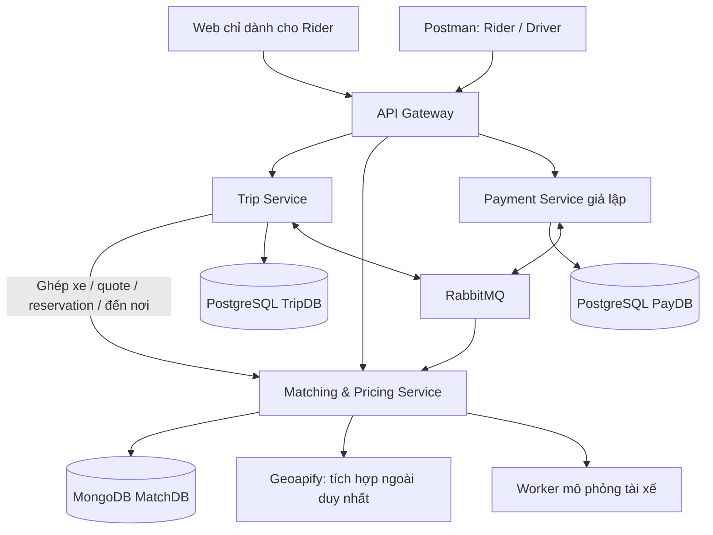
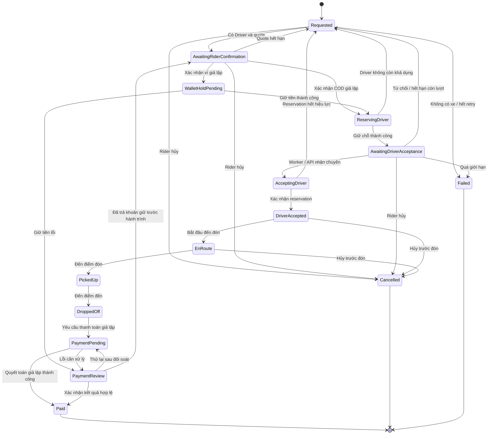

> **Tài liệu lịch sử.** Bản triển khai theo PDF và sơ đồ hiện hành nằm trong [README](README.md#kiến-trúc-và-vòng-đời).

# SwiftRide — Chức năng và luồng hoạt động mô phỏng

**Phạm vi mục tiêu theo yêu cầu cập nhật:** hệ thống mô phỏng đặt xe tại TP. Hồ Chí Minh,
ưu tiên xử lý nghiệp vụ và kiểm thử API bằng **Postman**. Toàn bộ tài khoản, tài xế,
hành trình và tiền là dữ liệu giả lập; **chỉ phần bản đồ giữ tích hợp hiện có**.

Hệ thống chỉ có đúng hai role tài khoản: **`rider`** (người đặt xe) và **`driver`** (tài xế).
Mỗi tài khoản seed nhận đúng một role; tên hiển thị tương ứng là Rider và Driver.

Tài liệu này thay thế mô tả phạm vi cũ, làm đặc tả cho việc chỉnh sửa dự án.
**Chưa có nghĩa mã nguồn đã được chuyển đổi hoặc bộ dữ liệu đã được tạo.**
Những API thay đổi/thêm mới dưới đây là hợp đồng mục tiêu, cần triển khai trước khi kiểm thử.

## 1. Phạm vi giữ lại và loại bỏ

| Hạng mục       | Phạm vi mục tiêu                                                                            |
| -------------- | ------------------------------------------------------------------------------------------- |
| Mục đích       | Mô phỏng luồng đặt xe, ghép tài xế, hành trình, thanh toán và xử lý lỗi                     |
| Tài xế         | Khoảng **1.000 Driver**, hồ sơ và tọa độ ngẫu nhiên trong khu vực TP.HCM                    |
| Người dùng     | Khoảng **100 Rider**, tài khoản và tọa độ ngẫu nhiên trong khu vực TP.HCM                   |
| Giao diện      | Chỉ Rider được đăng nhập web; giữ màn hình Rider tối thiểu để minh họa luồng                |
| Đăng ký        | Bỏ toàn bộ giao diện/API đăng ký; tài khoản được tạo sẵn bằng công cụ seed cục bộ           |
| Driver         | Không có giao diện đăng nhập/dashboard riêng; thao tác qua API/Postman hoặc worker mô phỏng |
| Vị trí         | Tọa độ seed và di chuyển mô phỏng; không GPS, không định vị thiết bị                        |
| Bản đồ         | Giữ Leaflet, lớp nền, tìm địa chỉ và tuyến Geoapify hiện có                                 |
| Thanh toán     | COD, ví, nạp/rút/hoàn đều mô phỏng nội bộ; không có tiền thật                               |
| Dịch vụ ngoài  | Chỉ gọi nhà cung cấp phục vụ bản đồ; không gọi dịch vụ thanh toán/xác thực ngoài            |
| Kiểm thử chính | Postman: request, response, trạng thái, dữ liệu, quyền, concurrency và xử lý sự cố          |

Không tích hợp VNPAY, ngân hàng, cổng thẻ, IPN, querydr, tunnel hoặc callback thanh toán.
Không dùng Keycloak/OIDC/SSO/Passkey trong phạm vi mới; xác thực chuyển sang nội bộ.
PostgreSQL, MongoDB, RabbitMQ và thư viện chạy cục bộ vẫn giữ để thực hiện nghiệp vụ.

## 2. Kiến trúc và trách nhiệm

Giữ ba service nghiệp vụ, Gateway và ranh giới dữ liệu hiện có; không thêm microservice mới.
Mô phỏng thay tác nhân và kết nối ngoài, còn trạng thái, transaction, message và sổ cái
vẫn phải được xử lý thật trong hệ thống cục bộ.

| Thành phần                   | Trách nhiệm                                                                   |
| ---------------------------- | ----------------------------------------------------------------------------- |
| Web Next.js                  | Đăng nhập Rider, chọn điểm trên map, minh họa đặt/theo dõi chuyến             |
| API Gateway                  | Xác thực token nội bộ, phân quyền, rate limit, định tuyến và tổng hợp dữ liệu |
| Trip Service / TripDB        | Hồ sơ Rider, chuyến, lịch sử, đánh giá và workflow/Saga                       |
| Matching & Pricing / MatchDB | Bộ Driver, tọa độ, ghép xe, reservation, giá và mô phỏng di chuyển            |
| Payment Service / PayDB      | Số dư giả lập, thu/hoàn COD giả lập, ví, journal và chống ghi trùng           |
| RabbitMQ/MassTransit         | Sự kiện nghiệp vụ, retry, Inbox/Outbox và hàng đợi lỗi                        |
| Công cụ seed cục bộ          | Tạo tài khoản, vị trí, số dư mẫu và dữ liệu có thể tái tạo                    |
| Geoapify/Leaflet             | Phần map giữ nguyên: địa chỉ, tọa độ, tuyến và hiển thị                       |
| Postman                      | Điều khiển tác nhân Rider/Driver và xác minh luồng API                        |



TripDB và PayDB có database/tài khoản riêng dù cùng instance PostgreSQL.
Không service nào truy vấn/ghi trực tiếp database nghiệp vụ của service khác.
Xác thực nội bộ dùng backend hiện có, không bổ sung một hệ thống quản lý danh tính độc lập.

## 3. Bộ dữ liệu mô phỏng tại TP.HCM

### 3.1. Khoảng 1.000 tài xế

Mỗi Driver có ID ổn định, tên giả, thông tin xe/biển số giả, tọa độ ban đầu, trạng thái
nhận chuyến, trạng thái bận và heartbeat. Dữ liệu không chứa thông tin cá nhân thật.
Tập mặc định dùng **1.000 Driver**, sẵn điều kiện nhận chuyến, chưa có reservation/chuyến.
Không có quy trình đăng ký, xét duyệt hoặc cấp mật khẩu tạm cho tài xế.

- Vị trí được random trong polygon vùng mô phỏng TP.HCM lưu cục bộ, ưu tiên khu vực nội đô.
- Không random trên toàn Việt Nam hoặc chỉ dựa bounding box có thể lọt ngoài vùng đã chọn.
- Sinh tọa độ bằng công cụ cục bộ; không gọi map API riêng cho từng bản ghi seed.
- Chỉ tìm đường khi chuẩn bị/thực hiện chuyến; ca kiểm thử chọn điểm có tuyến hợp lệ.
- Tọa độ hiện tại thay đổi theo mô phỏng; không random lại vị trí khi Driver đang phục vụ.
- Worker cập nhật heartbeat theo lô, khoảng 10 giây/lần; chỉ mô phỏng di chuyển Driver có chuyến.
  Không cần 1.000 trình duyệt, kết nối đăng nhập hoặc tiến trình riêng.

### 3.2. Khoảng 100 Rider

Mỗi Rider có ID, username, thông tin đăng nhập seed, tên/liên hệ giả, tọa độ ban đầu và ví mẫu.
Tập mặc định dùng **100 Rider**, mỗi người có một điểm xuất phát random trong cùng vùng TP.HCM.
Vị trí Rider dùng để điền điểm đón mặc định; Rider/Postman vẫn có thể chọn điểm đón/đến khác.
Vị trí người dùng không lấy từ điện thoại hoặc API định vị trình duyệt.

Các tài khoản có tên dễ nhận biết như `rider001`–`rider100`; dữ liệu Driver có ID tương ứng
để Postman xác định đúng tài xế được ghép. Bộ seed chỉ tạo hai nhóm tài khoản `rider` và `driver`;
kịch bản kiểm thử được cấu hình cục bộ, không tạo thêm tài khoản quản trị.

### 3.3. Quy tắc seed

- Dùng random seed cố định để tái tạo cùng bộ vị trí/ID khi cần so sánh kết quả.
- Tạo đủ dữ liệu liên quan giữa các service qua công cụ seed, giữ nguyên quyền sở hữu DB.
- Chạy lại không nhân đôi tài khoản, ví hoặc tài xế, không ghi đè chuyến/sổ cái đang có.
- Dùng dữ liệu kiểm thử riêng; reset dữ liệu demo phải là thao tác chủ động, không tự xóa volume.
- Số dư Rider ban đầu đủ cho ca thanh toán ví chuẩn; ca thiếu tiền dùng fixture riêng.
  Nếu khởi tạo số dư khác 0, ghi journal mở số dư để sổ cái vẫn đối chiếu được.
- Kịch bản lỗi dùng dữ liệu có chủ đích; không phụ thuộc kết quả random để quyết định pass/fail.

## 4. Đăng nhập nội bộ và giao diện Rider

### 4.1. Đăng nhập

1. Rider mở web, nhập tài khoản được tạo sẵn; không có nút/link/trang đăng ký.
2. Backend xác thực tài khoản cục bộ rồi cấp token có ID, role `rider`/`driver` và hạn dùng.
   Role lấy từ tài khoản seed, không cho client tự chọn khi đăng nhập.
3. Web giữ phiên bằng cookie HttpOnly, gọi API qua proxy; không đưa token vào URL.
4. Rider đăng xuất để kết thúc phiên; hết hạn thì đăng nhập lại.

Mật khẩu seed được hash; signing key và thông tin đăng nhập cấu hình ngoài mã nguồn.
Không triển khai OTP, email xác minh, mạng xã hội, Passkey hoặc luồng tạo tài khoản công khai.

**Chỉ role `rider` được vào giao diện web.** Driver dùng tài khoản seed để lấy token qua Postman,
không có giao diện đăng nhập riêng. Vai trò và ID lấy từ token đã xác thực,
không tin `riderId`/`driverId` tùy ý trong request.

Rider chỉ truy cập chuyến và ví của mình. Driver chỉ thao tác chuyến được giao, xe và ví của mình;
không có quyền xem toàn hệ thống hoặc thực hiện thao tác tài chính thay tài khoản khác.
Worker không phải tài khoản người dùng. Giao tiếp giữa các service dùng thông tin xác thực máy
tách biệt, không tạo thêm role tài khoản; token Rider/Driver không được gọi API nội bộ.

### 4.2. Giao diện tối thiểu

Giữ đăng nhập/đăng xuất Rider, bản đồ, chọn điểm, gửi yêu cầu và theo dõi trạng thái chuyến.
Dùng tọa độ Rider seed làm điểm đón ban đầu; chọn địa chỉ hoặc chạm map để đổi điểm.
Bỏ nút xin quyền định vị và mọi lời gọi GPS/geolocation; thao tác “về vị trí của tôi”, nếu giữ,
chỉ quay về tọa độ mô phỏng của tài khoản.

Không cần làm dashboard Driver, giao diện quản trị hoặc trang thanh toán bên ngoài.
Các chức năng lịch sử, đánh giá, ví và xử lý yêu cầu được kiểm thử qua API; chỉ giữ phần hiển thị
Rider cần cho việc minh họa luồng, không đặt giao diện làm trọng tâm nghiệm thu.

## 5. Luồng đặt xe và ghép tài xế

1. Rider đăng nhập từ web hoặc Postman, lấy tọa độ seed hoặc chọn hai điểm trong vùng mô phỏng.
2. Gọi map/quote để xem tuyến xe máy, khoảng cách, thời gian và giá tham khảo.
3. Tạo chuyến với `Idempotency-Key`, hai điểm khác nhau, liên hệ giả và phương thức `Cod`/`Wallet`.
4. Trip lưu `Requested`; worker gọi Matching tìm Driver gần điểm đón, bán kính mặc định **5 km**.
5. Chỉ chọn Driver đang nhận chuyến, không bận/khóa, heartbeat còn hạn **60 giây**,
   không có reservation còn hiệu lực và không nằm trong danh sách bị loại của chuyến.
6. Trip lấy quote có hạn **120 giây**, chuyển `AwaitingRiderConfirmation`.
7. Rider xác nhận đúng quote ID và `ExpectedVersion`. Chuyến ví giữ tiền trước; COD đi thẳng
   đến bước reservation.
8. Matching giữ chỗ nguyên tử với lease **60 giây**; thành công thì `AwaitingDriverAcceptance`.
9. Driver giả lập nhận qua worker trong ca chuẩn, hoặc Postman gửi nhận/từ chối theo kịch bản.
   Không cần người đăng nhập giao diện tài xế.
10. Sau xác nhận reservation, Trip vào `DriverAccepted`; Driver được đánh dấu bận.

Không có Driver phù hợp thì `Failed`. Driver từ chối/hết hạn làm giải phóng reservation,
loại Driver đó rồi tìm lại và lấy giá mới để Rider xác nhận. Giữ giới hạn `k = 3`:
lần từ chối/hết hạn thứ tư kết thúc `Failed`. Quote hết hạn được lấy lại, không dùng giá cũ.

### Giá mô phỏng

```text
Giá = round(((Đơn giá/km × km + Đơn giá/phút × phút) × Surge + Toll)
            × Promotion × (1 + Tax))
```

Giữ mặc định **10.000 VND/km**, **500 VND/phút**, `Surge = 1`, `Toll = 0`,
`Promotion = 1`, `Tax = 0.1`. Giá là tiền giả lập, tính bằng `decimal`, làm tròn cuối
về VND nguyên đồng. Khoảng cách/thời gian lấy từ map; tiền thanh toán lấy từ quote phía server.

## 6. Trạng thái và mô phỏng hành trình



Sơ đồ thể hiện nhánh chính; transition phải được kiểm soát tại Domain.
`DroppedOff` chuyển tiếp sang `PaymentPending`; không xem trả khách là đã thanh toán.

- Worker di chuyển xe theo tuyến map, cập nhật khoảng mỗi giây; không nhận GPS thật.
- Chặng `EnRoute` đi từ vị trí Driver đến điểm đón; `PickedUp` đi từ điểm đón đến điểm đến.
- Postman điều khiển tốc độ **1×/5×/10×/20×**, tạm dừng và tiếp tục.
- Trước khi đón/trả, backend kiểm tra đúng chuyến, đúng chặng và khoảng cách đến cuối tuyến
  không quá **100 m**, dựa hoàn toàn trên tọa độ mô phỏng.
- Restart tiếp tục từ tiến độ đã lưu; không cộng bù thời gian ứng dụng ngừng.
- Driver bận không được tự đổi tọa độ hoặc nhận thêm chuyến; Rider chỉ xem xe của chuyến mình.

### Hủy, lịch sử và đánh giá

Rider/Driver được hủy trước đón theo state machine; từ `DriverAccepted`/`EnRoute` cần lý do,
tối đa 240 ký tự. Driver chưa nhận dùng từ chối; không hủy sau `PickedUp`.
Trong lúc chờ giữ ví, đợi kết quả giữ tiền trước khi hủy.

Hủy/tìm lại giải phóng đúng reservation và khoản giữ ví còn hiệu lực; không để Driver kẹt bận
hoặc Rider bị giữ tiền sau khi chuyến đã kết thúc lỗi. Trạng thái trung gian lỗi cần retry/bồi thường.
Lịch sử có lọc/phân trang. Đặt lại chỉ điền địa chỉ, tạo chuyến và quote mới khi Rider gửi yêu cầu.
Đánh giá 1–5 sao, nhận xét tối đa 500 ký tự sau trả khách; gửi lặp không tạo đánh giá thứ hai.

## 7. Thanh toán hoàn toàn giả lập

Không có kết nối thanh toán ra ngoài. Payment Service tự xử lý kết quả mô phỏng trong DB,
phát sự kiện qua broker và ghi sổ cái. Ca chuẩn thành công; ca lỗi/từ chối/timeout được điều khiển
bằng fixture kiểm thử cục bộ, không dùng random không kiểm soát.

### 7.1. COD giả lập

1. Trả khách phát `RideCompleted`; Payment tạo giao dịch `Pending` với số tiền từ quote.
2. Worker hoặc Postman mô phỏng Driver xác nhận đã thu tiền; không cần trao tiền thật.
3. Payment khóa giao dịch, kiểm tra key/quyền, ghi journal thu và chuyển `Settled`.
4. `PaymentSettled` đưa Trip về `Paid`, giải phóng Driver/reservation.
5. Driver của chuyến qua Postman mô phỏng hoàn khoản COD đã `Settled`: ghi lý do,
   journal đảo và trạng thái `Refunded`. Số tiền lấy từ giao dịch gốc, không nhận số tiền tùy ý.

Driver vẫn bận khi COD còn chờ xác nhận. Thu/hoàn lặp không tạo thêm bút toán;
chỉ Driver của chuyến được xác nhận thu/hoàn, không có thu hộ; hoàn cần lý do.
Cờ xác nhận chỉ là bước nghiệp vụ mô phỏng.

### 7.2. Ví giả lập

- Ví có `Available`, `Held`, `PendingEarnings`, đều là số dư mô phỏng không âm.
- Khi Rider xác nhận quote, giữ đúng số tiền từ `Available` sang `Held` trước khi giữ chỗ Driver.
- Thiếu tiền thì trả lỗi nghiệp vụ, không gửi lời mời nhận chuyến.
- Khi hoàn tất hành trình, giảm khoản giữ Rider, cộng thu nhập vào `Available` của Driver,
  ghi journal/lịch sử và phát `PaymentSettled`.
- Hủy, hết lượt tìm xe hoặc lỗi trước quyết toán phải trả khoản giữ; khoản đã quyết toán
  không được xử lý như khoản giữ chưa dùng.
- Hoàn chuyến ví sau quyết toán không thuộc phạm vi bản tối thiểu; ca hoàn tiền dùng COD giả lập.

### 7.3. Nạp/rút nội bộ

**Nạp ví:** Rider gọi API với key và số tiền **10.000–5.000.000 VND**; backend ghi nhận
nạp giả lập, cộng `Available` và journal/lịch sử cùng transaction. Không checkout URL,
Return URL, chữ ký nhà cung cấp hoặc callback. API nạp demo không được bật trong môi trường tiền thật.

**Rút ví:** Rider/Driver gửi yêu cầu **10.000–5.000.000 VND**, không vượt khả dụng;
Payment giữ tiền, tạo `Pending`. Worker nội bộ tự xử lý theo fixture: ca chuẩn giảm khoản giữ,
ghi `SimulatedWithdrawalClearing` rồi chuyển `Completed`; ca từ chối ghi lý do, trả khoản giữ
về khả dụng và chuyển `Rejected`. Rider/Driver chỉ gửi và xem yêu cầu của mình, không có API
tự duyệt hoặc quyết định yêu cầu của người khác. Không thu thập tài khoản ngân hàng hoặc chuyển khoản.

## 8. Hợp đồng API mục tiêu

Postman gọi trực tiếp Gateway, ví dụ `{{baseUrl}} = http://localhost:8080`.
Web Rider gọi qua proxy Next.js. Giữ endpoint nghiệp vụ phù hợp hiện có; thay đổi cách xác thực,
seed và nạp ví để bỏ phụ thuộc ngoài. Bảng này là đặc tả mục tiêu, không xác nhận API mới đã tồn tại.

| Nhóm                         | Endpoint                                                                                      | Tác nhân                                                  |
| ---------------------------- | --------------------------------------------------------------------------------------------- | --------------------------------------------------------- |
| Đăng nhập nội bộ cần bổ sung | `POST /auth/login`                                                                            | Tài khoản seed `rider`/`driver`; web chỉ cho `rider`      |
| Hồ sơ                        | `GET/PUT /profiles/me`                                                                        | Chính chủ                                                 |
| Tạo/đọc chuyến               | `POST /trips`; `GET /trips`, `/trips/{id}`, `/trips/history`                                  | Tạo: Rider; đọc: Rider của chuyến/Driver được giao        |
| Xác nhận giá                 | `POST /trips/{id}/confirm-quote`                                                              | Rider của chuyến                                          |
| Nhận/từ chối                 | `GET /drivers/me/offers`; `POST /trips/{id}/driver-accept`, `/driver-reject`                  | Driver qua API/worker                                     |
| Hành trình                   | `POST /trips/{id}/en-route`, `/pickup`, `/dropoff`                                            | Driver qua API/worker                                     |
| Hủy/đánh giá                 | `POST /trips/{id}/cancel`, `/review`                                                          | Theo quyền và trạng thái                                  |
| Map/giá giữ lại              | `GET /maps/search`, `/maps/reverse`; `POST /maps/route`, `/quote`                             | Đã đăng nhập                                              |
| Vị trí giả lập/nhận chuyến   | `GET /drivers/me`; `PUT /drivers/me/location`, `/availability`, `/heartbeat`                  | Driver/worker theo quyền                                  |
| Điều khiển xe                | `GET/PUT /simulations/{driverId}`                                                             | Driver của xe                                             |
| Màn hình tổng hợp            | `GET /screens/trips/{id}`                                                                     | Theo quyền chuyến                                         |
| Ghép xe nội bộ               | `POST /match`, `/reservations`, `/reservations/confirm`, `/reservations/release`, `/arrivals` | Máy nội bộ đã xác thực                                    |
| Payment                      | `GET /payments/{id}`, `/payments/history`, `/payments/statistics`, `/payments/{id}/ledger`    | Rider/Driver theo chuyến; thống kê chỉ phạm vi chính mình |
| Tạo payment nội bộ           | `POST /payments`                                                                              | Máy nội bộ đã xác thực                                    |
| Thu/hoàn COD giả lập         | `POST /payments/{id}/confirm-cash`, `/refund`                                                 | Driver của chuyến                                         |
| Thử lại payment              | `POST /trips/{id}/retry-payment`                                                              | Driver của chuyến, chỉ COD ở `PaymentReview`              |
| Ví/lịch sử                   | `GET /wallets/me`, `/wallets/history`, `/wallets/topups`                                      | Chính chủ                                                 |
| Nạp giả lập, cần sửa hành vi | `POST /wallets/topups`                                                                        | Rider, không gọi nhà cung cấp                             |
| Rút giả lập                  | `GET/POST /wallets/withdrawals`                                                               | Chính Rider/Driver gửi hoặc xem; worker xử lý             |
| Sức khỏe/tài liệu            | `GET /health/live`, `/health/ready`; OpenAPI qua Gateway                                      | Theo policy                                               |

Không có endpoint đăng ký hoặc tạo tài khoản công khai. Tài khoản chỉ được cấp bởi seed.
Không có API quản trị/duyệt rút; Driver thử lại payment phải qua kiểm tra trạng thái,
quyền sở hữu và idempotency, không đổi số tiền hoặc bỏ qua bước quyết toán.
Loại bỏ API/UI sandbox VNPAY, IPN, reconcile/querydr và luồng cấp tài khoản qua Keycloak.
Công cụ seed là thao tác phát triển cục bộ, không phải API public có quyền sửa dữ liệu tùy ý.

## 9. Kiểm thử chính bằng Postman

### 9.1. Chuẩn bị collection

Environment gồm `baseUrl`, thông tin đăng nhập seed và token cho hai role `rider`/`driver`;
biến luồng gồm `tripId`, `driverId`, `quoteId`, `expectedVersion`, `idempotencyKey`.
Sau mỗi response, lấy ID/version mới từ server; không gán cứng ID hoặc bỏ kiểm tra quyền.

Seed tạo danh sách ID và tài khoản fixture để tester chọn đúng Driver được ghép.
Collection có nhóm Auth, Maps/Pricing, Trips, Matching/Drivers, Simulation, Payments, Wallets
và Recovery. Request nội bộ dùng thông tin xác thực máy dành riêng môi trường kiểm thử;
không tạo role thứ ba hoặc cấp quyền gọi API nội bộ cho Rider/Driver.
Ca hoàn COD/thử lại payment dùng Driver của chuyến; ca rút tiền chờ worker xử lý,
không có bước đăng nhập quản trị hoặc gọi API duyệt rút.

Chờ workflow/message bằng polling có khoảng nghỉ và timeout, ví dụ tối đa 60 giây mỗi bước.
Hết timeout phải báo lỗi với trạng thái cuối/`CorrelationId`, không chờ vô hạn hoặc chỉ sleep
rồi mặc định thành công. Với dữ liệu random, chọn Rider/Driver từ fixture và kiểm tra điều kiện
trước khi chạy ca; giá kỳ vọng tính từ quote/route trả về.

### 9.2. Ca chuẩn theo thứ tự

1. Kiểm tra readiness, bộ seed có 1.000 Driver và 100 Rider, tọa độ đúng vùng mô phỏng.
2. Đăng nhập một Rider seed; lấy hồ sơ, điểm đón và số dư mô phỏng.
3. Chọn điểm đến hợp lệ, gọi route/quote, tạo chuyến với key mới.
4. Chờ `AwaitingRiderConfirmation`, lưu quote ID/version rồi xác nhận.
5. Với ví, kiểm tra khoản giữ; lấy Driver được ghép và token fixture tương ứng.
6. Driver nhận qua API hoặc worker; chờ `DriverAccepted` và kiểm tra reservation/busy.
7. Chuyển `EnRoute`, điều khiển mô phỏng; đến điểm đón thì gọi `pickup`.
8. Tiếp tục mô phỏng đến điểm đến, gọi `dropoff`; chờ tạo giao dịch.
9. COD: gọi xác nhận thu giả lập. Ví: chờ quyết toán tự động từ khoản giữ.
10. Kiểm tra Trip `Paid`, payment `Settled`, Driver được giải phóng, ledger cân bằng,
    số dư/lịch sử đúng. Gửi lại request/message phù hợp để kiểm tra không ghi trùng.

### 9.3. Ma trận ca lỗi bắt buộc

| Kịch bản                                  | Kết quả cần kiểm tra                                     |
| ----------------------------------------- | -------------------------------------------------------- |
| Sai mật khẩu/token hết hạn/sai role       | `401/403`, không phát sinh thay đổi nghiệp vụ            |
| Rider gọi API chỉ dành cho Driver         | `403`, không đổi xe, thu/hoàn hoặc retry payment         |
| Driver thao tác xe/chuyến của Driver khác | `403`, không có quyền thao tác hộ                        |
| Token Rider/Driver gọi API nội bộ         | `403`, không được tạo payment hoặc reservation trực tiếp |
| Truy cập chuyến/ví người khác             | Từ chối, không lộ dữ liệu                                |
| Tọa độ sai, hai điểm trùng, số tiền sai   | Lỗi đầu vào, không tạo giao dịch/chuyến lỗi              |
| Gửi lại cùng key/cùng nội dung            | Cùng kết quả, không nhân đôi dữ liệu                     |
| Dùng lại key nhưng đổi nội dung           | `409`, không ghi đè yêu cầu trước                        |
| `ExpectedVersion` cũ                      | `409`, tải lại trạng thái mới                            |
| Không có Driver trong 5 km                | `Failed`, không kẹt reservation/khoản giữ                |
| Nhiều chuyến tranh một Driver             | Chỉ một reservation có hiệu lực                          |
| Driver từ chối/lời mời hoặc quote hết hạn | Tìm lại/quote mới hoặc kết thúc đúng giới hạn            |
| Hủy trước đón                             | Đúng quyền, đúng lý do, giải phóng xe và trả khoản giữ   |
| Đón/trả khi xe chưa đến                   | Bị chặn dù client gửi trạng thái hợp lệ                  |
| Ví thiếu tiền                             | Không gửi lời mời; không âm số dư/không treo tiền        |
| Nạp/rút/quyết toán đồng thời              | Không mất cập nhật, không nhân đôi journal               |
| Thu COD/hoàn/rút bị gửi lặp               | Chỉ một quyết định và bộ bút toán hợp lệ                 |
| Payment giả lập lỗi/timeout               | Retry hoặc `PaymentReview`, không báo `Paid` giả         |
| RabbitMQ ngừng rồi phục hồi               | Outbox giữ event, xử lý tiếp khi broker hoạt động        |
| Restart Trip/Payment/Matching             | Khôi phục workflow/mô phỏng, không lặp thu/hoàn          |
| Đánh giá lặp/sai sao/sai quyền            | Idempotent hoặc bị từ chối đúng quy tắc                  |

Postman Collection Runner chạy tuần tự làm kiểm tra chính. Ca concurrency dùng runner/công cụ
API hỗ trợ gửi đồng thời; không xem chạy tuần tự là bằng chứng chống tranh chấp.
Unit/integration test sẵn có vẫn hỗ trợ kiểm tra ràng buộc DB và logic khó tái hiện qua HTTP.
Giao diện chỉ cần smoke test đăng nhập Rider, map và theo dõi một chuyến; không lấy browser
nhiều vai trò hoặc giao dịch nhà cung cấp làm điều kiện nghiệm thu.

## 10. Tính nhất quán và vận hành

- Giữ State, Strategy, Repository, Factory, Saga, Pub/Sub và Outbox phù hợp kiến trúc hiện tại.
- Lệnh chuyến kiểm tra version; reservation MongoDB nguyên tử; ví/payment có transaction và lock.
- Journal ghi kép cân bằng và bất biến; mọi khoản nạp/giữ/thu/hoàn/rút đều có dấu vết.
- Retry hữu hạn/backoff, bồi thường tài nguyên và hàng đợi lỗi; gửi lặp không tạo hiệu ứng thứ hai.
- Lỗi trả mã HTTP phù hợp và `CorrelationId`; log không chứa mật khẩu, token hoặc secret map.
- Chạy local, tổng RAM dự án/build/test/container tối đa **12 GB**; build/test nặng tuần tự.
- Chỉ bật service cần thiết và dependency; observability bật theo profile khi cần tra lỗi.
- Một worker xử lý nhiều đối tượng; không gọi map API liên tục cho 1.100 vị trí hoặc mỗi tick xe.
- Seed/reset không tự chạy lại để ghi đè dữ liệu khi restart; không xóa volume để giảm RAM.

Số lượng 1.000 Driver/100 Rider là quy mô dữ liệu mẫu, không phải cam kết chịu 1.100
người dùng đồng thời hoặc kết quả load test. Map vẫn cần mạng/API key theo cấu hình hiện có;
không tuyên bố hệ thống hoàn toàn offline.

## 11. Những phần mã cần đổi để đạt đặc tả

| Mảng       | Thay đổi cần thực hiện                                                                           |
| ---------- | ------------------------------------------------------------------------------------------------ |
| Dữ liệu    | Bổ sung seed có thể tái tạo: 1.000 Driver, 100 Rider, tọa độ TP.HCM, số dư và tài khoản thử      |
| Xác thực   | Đúng hai role `rider`/`driver`, đăng nhập nội bộ; bỏ role/tài khoản quản trị, đăng ký và Passkey |
| Web        | Chỉ cho Rider truy cập, bỏ trang Driver/quản trị, mọi đăng ký và GPS/geolocation                 |
| Matching   | Dùng Driver seed, heartbeat/nhận chuyến mô phỏng, giữ ghép xe và reservation                     |
| Hành trình | Duy trì mô phỏng theo tuyến map và kiểm tra đến nơi, điều khiển được từ API                      |
| Payment    | Hoàn/retry thuộc Driver của chuyến; worker xử lý rút; nạp nội bộ, giữ ledger/idempotency         |
| Cấu hình   | Bỏ dependency Keycloak và biến/callback/tunnel thanh toán; giữ map và ba DB nghiệp vụ            |
| Kiểm thử   | Cập nhật collection/environment Postman, fixture và ca lỗi; bỏ nghiệm thu đăng ký/VNPAY/GPS      |

Tài liệu nguồn để đối chiếu khi triển khai: [bản đồ mã nguồn](source-guide.md),
[kiến trúc](architecture.md), [Docker Compose](../docker-compose.yml), [Makefile](../Makefile).
Các tài liệu khác và bộ test cũ cần được cập nhật sau khi mã đã chuyển sang phạm vi này.
