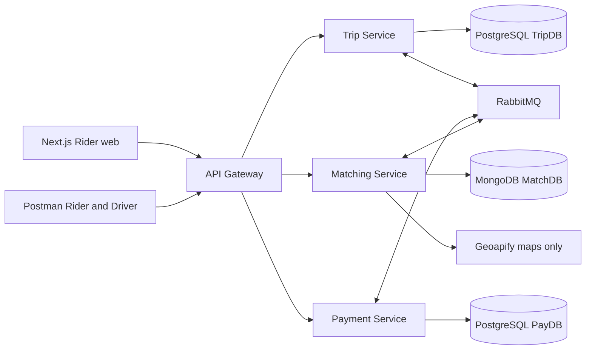

# Current architecture

The authoritative scope is [`chuc-nang-va-luong-hoat-dong.md`](../chuc-nang-va-luong-hoat-dong.md).
This document describes the implemented local system and supersedes the old Keycloak/VNPAY/Ops design.

- Web authentication is local seeded Rider authentication. Driver accounts use API/Postman only.
- The only account roles are `rider` and `driver`; machine-to-machine JWTs are not user roles.
- Trip, Matching, and Payment own separate data stores. There is no SQL Server, Keycloak, or fourth
  business service in the active Compose stack.
- Geoapify is the only external integration. Fares, COD collection, wallet funding, and withdrawals
  are simulations; no bank transfer or payment-provider request is made.
- Old VNPAY/checkout migration records are retained as historical schema/data for existing volumes.
  They have no active route, worker, provider, or frontend flow.

## Trip workflow

`Requested -> AwaitingRiderConfirmation -> ReservingDriver -> AwaitingDriverAcceptance ->
DriverAccepted -> EnRoute -> PickedUp -> PaymentPending -> Paid`.

The trip worker asks Matching for an eligible nearby seeded Driver. Rider wallet confirmation holds
funds before the reservation request. A failed hold never creates an offer. Rejected or expired
offers release both the reservation and wallet hold before rematching. COD does not create a wallet
hold. COD collection is recorded by the assigned Driver after dropoff.

Wallet settlement transfers the Rider hold to a Driver wallet credit in one Payment DB transaction
and writes balanced ledger entries. COD settlement records cash received by the Driver and never
credits the Driver wallet. Withdrawal requests move available funds to held funds; a local worker
settles or rejects them exactly once.

## Local data and migrations

Seed data is additive and deterministic: 100 Rider accounts/profiles and 1,000 Driver records in
Ho Chi Minh City. Startup does not reset existing accounts, trips, wallets, or ledgers. Existing
volumes must be kept; do not remove volumes to re-seed. PostgreSQL TripDB and PayDB share an
instance but have separate database users. MongoDB stores Matching data.
