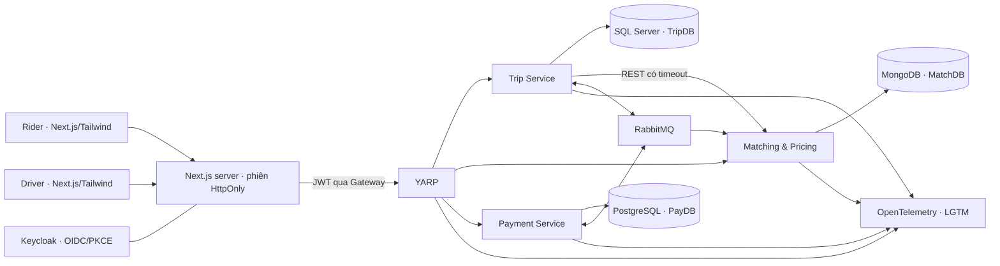
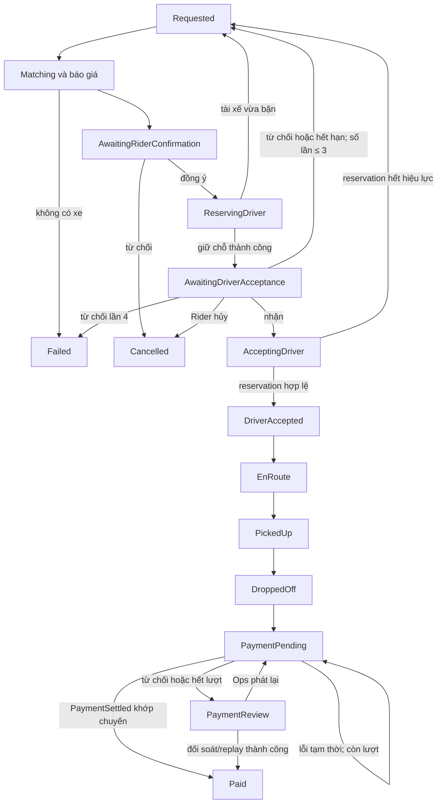

# Kiến trúc SwiftRide

## Client và container



Presentation kiểm tra đầu vào để phản hồi nhanh; server kiểm tra lại mọi quyết định nghiệp vụ. Next.js giữ token phía server, client gọi same-origin proxy; proxy chỉ chuyển tiếp vào Gateway. YARP định tuyến, kiểm tra JWT, rate limit và gom dữ liệu `/screens/trips/{id}`. Service tự kiểm tra JWT cùng quyền tài nguyên, không tin RiderId/DriverId từ browser.

Có đúng ba service nghiệp vụ và ba database nghiệp vụ, dùng ba công nghệ trong PDF. Keycloak, broker và monitoring là hạ tầng. Không có Auth Service tự viết, BFF Rider/Driver riêng hoặc database dùng chung giữa các service.

## Dữ liệu và chủ sở hữu

| Bounded context | Dữ liệu sở hữu | Ràng buộc |
|---|---|---|
| Trip | Trip, snapshot báo giá, lịch sử trạng thái, phiên bản, tiến trình Saga, Inbox/Outbox | Index duy nhất Rider + idempotency key; mỗi Rider tối đa một chuyến đang thực hiện; optimistic concurrency |
| Matching | Driver, GeoJSON, online/busy, TripId/ReservationId, hạn giữ chỗ | Index 2dsphere; cập nhật nguyên tử theo reservation; không dùng TTL xóa tài xế |
| Payment | Payment, Wallet, Journal, provider operation demo, Inbox/Outbox | Một payment/chuyến; khóa transaction theo TripId; khóa số dư; journal cân bằng và append-only |

Trip và Payment giữ strong consistency trong transaction nội bộ; giữa service dùng eventual consistency. Client hiển thị trạng thái trung gian thay vì đoán thành công. EF value converter lưu snapshot bất biến và lịch sử trong JSON text; có ValueComparer cho các collection thay đổi.

GeoJSON theo thứ tự **longitude, latitude**. Mongo chỉ tìm tài xế online, không busy, vị trí còn mới và không có reservation còn hạn. Kiểm tra sơ bộ và cập nhật giữ chỗ là hai bước khác nhau; quyết định cuối dùng atomic find-and-update. ReservationId đóng vai trò fencing token: event giải phóng cũ không xóa reservation mới.

## Vòng đời



Mỗi lần tìm lại tạo báo giá mới và yêu cầu Rider xác nhận lại. Báo giá 120 giây, lời mời 60 giây; driver bị từ chối được loại khỏi các lần tìm tiếp. Quote hết hạn tự quay lại bước báo giá. Khi không còn tài xế, kết thúc sớm `Failed`.

`Requested`, `ReservingDriver`, `AcceptingDriver` cùng deadline được lưu trong SQL Server; BackgroundService tiếp tục sau restart. Mạng lỗi không làm mất ý định đã lưu: lỗi tạm thời được trì hoãn bằng backoff/jitter tối đa ba lần ở Saga; lỗi vĩnh viễn hoặc hết lượt chuyển Failed và giải phóng reservation. Từng lời gọi HTTP cũng có timeout/retry hữu hạn. Trạng thái trung gian chỉ được thay đổi theo State pattern. Sau nhận chuyến, bản demo không hỗ trợ hủy hành trình đang thực hiện.

## Sequence thành công và ranh giới transaction

```mermaid
sequenceDiagram
    actor Rider
    actor Driver
    participant G as Gateway
    participant T as Trip/SQL Server
    participant M as Matching/MongoDB
    participant B as RabbitMQ
    participant P as Payment/PostgreSQL
    Rider->>G: POST /trips + Idempotency-Key
    G->>T: JWT và request
    T-->>Rider: 201 Requested
    T->>M: POST /match, POST /quote
    T->>T: Lưu báo giá, AwaitingRiderConfirmation
    Rider->>T: Confirm qua Gateway, expectedVersion + quoteId
    T->>T: Lưu ReservingDriver
    T->>M: Giữ chỗ nguyên tử
    T->>T: AwaitingDriverAcceptance
    Driver->>T: Nhận qua Gateway
    T->>T: Lưu AcceptingDriver
    T->>M: Chốt reservation thành busy
    T->>T: DriverAccepted + Outbox trong cùng transaction
    Driver->>T: Đang đến, pickup, dropoff qua Gateway
    T->>T: DroppedOff, PaymentPending + Outbox cùng transaction
    T->>B: Worker phát RideCompleted
    B->>M: Giải phóng tài xế, idempotent
    B->>P: RideCompleted, có thể giao nhiều lần
    P->>P: Provider dùng cùng khóa; Payment + Journal + Outbox
    P->>B: PaymentSettled
    B->>T: Kiểm tra ID, số tiền, tiền tệ; đổi Paid
```

Mũi tên actor tới Trip trong sơ đồ rút gọn vẫn đi qua Next.js/Gateway. Không có client truy cập trực tiếp service.

## Hợp đồng API

Payload enum dùng chuỗi, JSON camelCase; tiền VND nguyên đồng. Lỗi nghiệp vụ dùng Problem Details và CorrelationId.

| Endpoint | Quyền | Payload chính |
|---|---|---|
| `POST /trips` | Rider | pickup/destination `{latitude,longitude,label}`, method, paymentToken; header Idempotency-Key |
| `GET /trips`, `GET /trips/{id}` | Chủ chuyến, Driver được giao hoặc Ops | Danh sách tối đa 50 chuyến; không trả token/hashes |
| `POST /trips/{id}/confirm-quote` | Rider sở hữu | expectedVersion, quoteId |
| `POST /trips/{id}/cancel` | Rider sở hữu | expectedVersion; chỉ trước bước nhận chuyến |
| `POST /trips/{id}/driver-accept`, `/driver-reject` | Driver được mời | expectedVersion |
| `POST /trips/{id}/en-route`, `/pickup`, `/dropoff` | Driver được giao | expectedVersion |
| `POST /trips/{id}/retry-payment` | Ops | expectedVersion; chỉ PaymentReview |
| `GET /drivers/me/offers` | Driver | Lời mời đang có hiệu lực |
| `PUT /drivers/me/location` | Driver | latitude, longitude |
| `PUT /drivers/me/availability` | Driver | available |
| `GET /drivers/me` | Driver | Vị trí, online/busy của mình |
| `POST /quote` | Đã đăng nhập | pickup, destination; giá do server quyết định |
| `POST /match` | Service, mạng nội bộ | pickup, excludedDrivers; trả `{driver: ... hoặc null}` |
| `POST /reservations`, `/reservations/confirm`, `/reservations/release` | Service, mạng nội bộ | tripId, reservationId, driverId |
| `POST /payments` | Service | tripId, riderId, amount, method, paymentToken, correlationId; khóa `trip:{id}:charge` |
| `GET /payments/{id}`, `/ledger` | Rider sở hữu, Service hoặc Ops | Giao dịch/bút toán; Driver không xem sổ cái Rider |
| `POST /payments/{id}/refund` | Ops | reason; Idempotency-Key |
| `GET /wallets/me` | Rider | Số dư ví mẫu |
| `GET /screens/trips/{id}` | Người có quyền xem chuyến | Gateway gom trip/payment; báo paymentUnavailable khi Payment tạm ngừng |
| `POST /payments/{id}/demo-recover` | Ops, Development | Cho phép provider demo ngừng lỗi để kiểm tra replay |

`400` dữ liệu sai; `401` chưa xác thực; `403` sai quyền; `404` không tồn tại; `409` trạng thái/phiên bản/key xung đột; `429` vượt hạn; `503` dịch vụ tạm thời lỗi. Gateway giới hạn 10 tạo chuyến/phút và 180 request khác/phút theo danh tính/IP. UI proxy giới hạn body 16 KiB; service vẫn kiểm tra tọa độ, tuyến, phương thức, số tiền và khóa.

Event dùng MassTransit envelope: message ID, CorrelationId, timestamp/trace context và SchemaVersion header = 1; payload có EventId, TripId và dữ liệu nghiệp vụ. Các consumer xử lý theo trạng thái hiện tại; duplicate settlement không tạo transition thứ hai.

## Tiền, Outbox và Saga

Công thức chuẩn: `((cd*d + ct*t)*s + cm)*η*(1+T)`. Dùng decimal, chỉ làm tròn cuối cùng AwayFromZero. Strategy không được trả số âm; kiểm thử hợp đồng cho cả ba implementation, không coi một runtime guard là bằng chứng LSP.

| Bút toán | Nợ | Có |
|---|---|---|
| Nạp ví mẫu | DemoFunding | WalletLiability:{rider} |
| Thu Wallet | WalletLiability:{rider} | TripPayable |
| Thu Card | ProviderReceivable | TripPayable |
| Hoàn tiền | Đảo từng dòng khoản thu | Đảo từng dòng khoản thu |

Khóa unique, advisory transaction lock theo TripId và row lock số dư ngăn thu trùng/âm ví. PostgreSQL CHECK kiểm tra số dư và bút toán; trigger cấm UPDATE/DELETE Journal. Sổ cái không bị chỉnh sửa để “sửa số tiền”.

Provider Card demo ghi vào transaction riêng trong PayDB, mô phỏng tác động bên ngoài tồn tại dù transaction thanh toán bị rollback. `demo-unknown` ghi capture trước rồi timeout; lần sau đọc lại operation cùng key. Đây không phải tích hợp cổng thật và không có cam kết giữa hai hệ thống tiền thật.

Trip là process manager của Saga, không dùng distributed transaction. Bồi thường reservation qua event khi hủy/từ chối/hết hạn. `demo-compensate` mô phỏng lỗi vĩnh viễn sau capture: hoàn provider và ghi cả Charge/Refund; Trip vào PaymentReview. Broker chậm không phải lý do hoàn tiền.

Trip/Payment dùng EF transactional outbox và consumer inbox của MassTransit: thay đổi dữ liệu và event cùng transaction; broker at-least-once, consumer vẫn kiểm tra idempotency nghiệp vụ. Matching chỉ nhận event để cập nhật Mongo idempotent, không có yêu cầu ghi data + publish event nên không thêm Mongo Outbox/replica set.

HTTP nội bộ timeout từng attempt 5 giây, tối đa 3 retry có backoff/jitter, deadline HttpClient 20 giây. Message retry exponential 3 lần; lỗi nghiệp vụ không retry. Sau đó queue `_error` giữ message, phát Fault để Trip vào PaymentReview. Replay bằng Shovel `on-confirm` giữ message ID; operator phải sửa nguyên nhân trước. Saga không thay thế transaction hoặc Outbox.

## SOLID và pattern

| Nguyên tắc | Mã minh họa |
|---|---|
| SRP | FareCalculator tính giá; TripRepository truy cập DB; TripWorkflow điều phối |
| OCP | Thêm implementation IPricingStrategy mà không sửa StandardPricing |
| LSP | Cùng tập đầu vào hợp lệ cho Standard/Surge/Promo: giá không âm, đầu vào sai bị từ chối |
| ISP | ITripReader và ITripWriter tách nhỏ |
| DIP | DI cho reader/writer, IPaymentMethod, IPublishEndpoint; application không tự tạo kết nối broker |

State = TripState; Strategy = IPricingStrategy; Repository = TripRepository/DriverRepository và EF DbContext/DbSet làm repository tại Payment; Factory = PaymentMethodFactory với hai implementation thật; Observer/Pub-Sub = consumer sự kiện; API Gateway = YARP; Saga = TripWorkflow + consumer thanh toán + bồi thường; Outbox = EF Bus/Consumer Outbox.

## Bảo mật, quan sát và trade-off

- OIDC Authorization Code + PKCE ở web; JWT resource server tại Gateway và service; client credentials cho nội bộ. Secret ngoài source; API không nhận dữ liệu thẻ thật.
- Kiểm tra quyền tài nguyên tại service; không cho Rider tự chọn số tiền hoặc Driver cập nhật chuyến người khác. API fault injection chỉ hoạt động Development và yêu cầu Ops.
- Log không chứa body/token; tắt EF command log thông thường, không bật SensitiveDataLogging. CorrelationId được kiểm tra định dạng GUID và truyền tiếp; W3C trace context đi qua HTTP và MassTransit.
- Dashboard có tỷ lệ thành công, matching p95, API p95, thanh toán lỗi, broker backlog, Outbox còn lưu và log. Dùng Tempo Explore để tìm trace theo trace ID.
- Polyglot persistence bám PDF nhưng tăng chi phí RAM, backup, migration và vận hành. Docker Compose phục vụ demo, không phải HA.
- Microservices phục vụ mục tiêu học kiến trúc; nhóm nhỏ triển khai sản phẩm ban đầu có thể chọn modular monolith để giảm độ phức tạp.
- Polling giảm hạ tầng realtime; thêm WebSocket khi có yêu cầu độ trễ/công suất. Không tự tạo framework CQRS, generic repository hoặc tầng abstract không được dùng.
