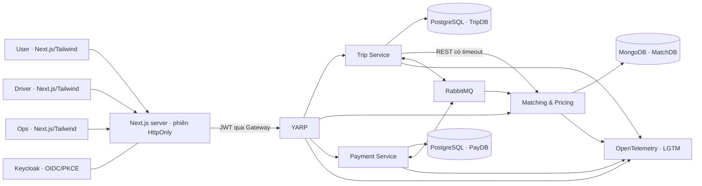
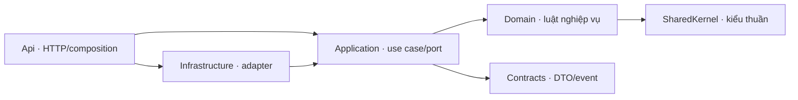
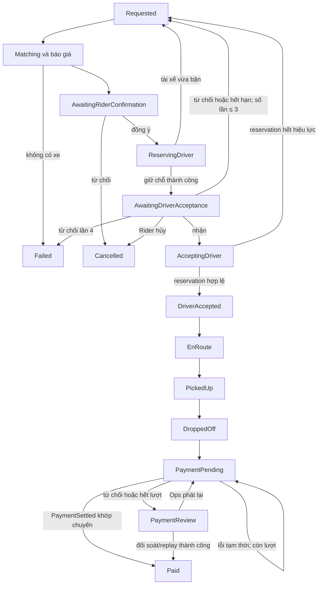

# Kiến trúc SwiftRide

## Client và container



Presentation kiểm tra đầu vào để phản hồi nhanh; server kiểm tra lại mọi quyết định nghiệp vụ. Next.js giữ token phía server, client gọi same-origin proxy; proxy chỉ chuyển tiếp vào Gateway. YARP định tuyến, kiểm tra JWT, rate limit và gom dữ liệu `/screens/trips/{id}`. Service tự kiểm tra JWT cùng quyền tài nguyên, không tin RiderId/DriverId từ browser.

Có đúng ba service nghiệp vụ và ba database nghiệp vụ, dùng PostgreSQL cho Trip/Payment và MongoDB cho Matching theo PDF §3.3. Keycloak, broker và monitoring là hạ tầng. Không có Auth Service tự viết, BFF Rider/Driver riêng hoặc bảng dữ liệu dùng chung giữa các service. TripDB/PayDB cùng instance PostgreSQL nhưng tách quyền CONNECT; runtime không dùng superuser. Một instance là điểm lỗi chung chấp nhận cho đồ án local.

Bản hiện tại dùng Geoapify cho tìm địa chỉ, geocoding ngược và đường đi; Leaflet
hiển thị bản đồ. Matching sở hữu Maps, Driver approval/presence và Simulation.
Simulation lưu tiến độ, tốc độ, trạng thái pause và revision trong MongoDB; tick
không bù thời gian downtime. Trip kiểm tra xe đến điểm đón/trả qua API Matching.
User đăng ký công khai; Driver chỉ được Keycloak cấp quyền sau Ops duyệt hồ sơ.
Ops và Driver không kế thừa quyền User. Keycloak giữ danh tính trong volume riêng.
Chuyến mới chỉ nhận `Cod`; giữ Factory/Strategy để mở rộng khi có yêu cầu.
Payment tạo khoản chờ thu sau trả khách; chỉ Driver được phân công hoặc Ops có lý do
xác nhận tiền mặt. Trip chỉ chuyển Paid khi nhận PaymentSettled hợp lệ.
Card/Wallet/VNPAY giữ dữ liệu lịch sử; endpoint ghi và worker online không được đăng ký.
Giữ ranh giới microservice; [quản lý chung qua Makefile](service-consolidation-proposal.md)
điều phối Compose, giữ riêng API/database và các tầng mã nguồn. Nhóm phát triển riêng
chỉ bật API, database và hạ tầng bắt buộc; `make up` bật luồng đầy đủ.

## Clean Architecture và chiều phụ thuộc

Mỗi service nghiệp vụ có bốn project độc lập, kiểm soát bằng ProjectReference:



Domain/Application không có PackageReference hay FrameworkReference. ASP.NET, EF Core, MongoDB.Driver, MassTransit, ClaimsPrincipal và HttpClient nằm ở tầng ngoài. Lỗi nghiệp vụ dùng `ErrorKind`; middleware ánh xạ thành HTTP status. JWT đã xác thực được chuyển thành `Actor` tại biên HTTP.

Application sở hữu port đọc/ghi, giao dịch, phát sự kiện, Matching và provider thanh toán. EF/Mongo/MassTransit triển khai port trong Infrastructure. `TripWorkflowWorker` quản lý scope/lịch chạy và gọi `TripWorkflow`; consumer chuyển message sang use case. `EfUnitOfWork` tham gia transaction consumer hiện có, chỉ commit transaction do chính nó mở để giữ tính nguyên tử Inbox/Outbox.

Frontend giữ chiều phụ thuộc tương tự: presentation gọi `RideService`; service phụ thuộc `RideGateway`; `HttpRideGateway` triển khai port. `composition/RideClient.tsx` ghép hai bên trong client boundary. React state/polling ở presentation; fetch ở infrastructure; Auth.js/token/proxy ở server infrastructure. Route Next.js nối handler hoặc composition.

`check-architecture.py` kiểm tra project reference từng tầng, cấm framework ở tầng trong, cấm endpoint truy cập persistence/broker trực tiếp và cấm import ngược tầng trên frontend. Kiểm tra tự động bảo vệ cấu trúc; review vẫn cần đánh giá ý nghĩa nghiệp vụ. [Bản đồ nguồn](source-guide.md) mô tả từng đường dẫn và cách thêm chức năng.

## Dữ liệu và chủ sở hữu

| Bounded context | Dữ liệu sở hữu                                                                       | Ràng buộc                                                                                                  |
| --------------- | ------------------------------------------------------------------------------------ | ---------------------------------------------------------------------------------------------------------- |
| Trip            | Trip, snapshot báo giá, lịch sử trạng thái, phiên bản, tiến trình Saga, Inbox/Outbox | Index duy nhất Rider + idempotency key; mỗi Rider tối đa một chuyến đang thực hiện; optimistic concurrency |
| Matching        | Driver, GeoJSON, online/busy, TripId/ReservationId, hạn giữ chỗ                      | Index 2dsphere; cập nhật nguyên tử theo reservation; không dùng TTL xóa tài xế                             |
| Payment         | Payment COD, dấu vết thu/hoàn, Journal, dữ liệu online cũ, Inbox/Outbox              | Một payment/chuyến; khóa transaction theo TripId; khóa số dư; journal cân bằng và append-only              |

Trip và Payment giữ strong consistency trong transaction nội bộ; giữa service dùng eventual consistency. Client hiển thị trạng thái trung gian thay vì đoán thành công. EF value converter lưu snapshot bất biến và lịch sử trong JSON text; có ValueComparer cho các collection thay đổi.

GeoJSON theo thứ tự **longitude, latitude**. Mongo chỉ tìm tài xế online, không busy, vị trí còn mới và không có reservation còn hạn. Kiểm tra sơ bộ và cập nhật giữ chỗ là hai bước khác nhau; quyết định cuối dùng atomic find-and-update. ReservationId đóng vai trò fencing token: event giải phóng cũ không xóa reservation mới.

## Vòng đời



Mỗi lần tìm lại tạo báo giá mới và yêu cầu Rider xác nhận lại. Báo giá 120 giây, lời mời 60 giây; driver bị từ chối được loại khỏi các lần tìm tiếp. Quote hết hạn tự quay lại bước báo giá. Khi không còn tài xế, kết thúc sớm `Failed`.

`Requested`, `ReservingDriver`, `AcceptingDriver` cùng deadline được lưu trong PostgreSQL; BackgroundService tiếp tục sau restart. Mạng lỗi không làm mất ý định đã lưu: lỗi tạm thời được trì hoãn bằng backoff/jitter tối đa ba lần ở Saga; lỗi vĩnh viễn hoặc hết lượt chuyển Failed và giải phóng reservation. Từng lời gọi HTTP cũng có timeout/retry hữu hạn. Trạng thái trung gian chỉ được thay đổi theo State pattern. Sau nhận chuyến, bản demo không hỗ trợ hủy hành trình đang thực hiện.

## Sequence thành công và ranh giới transaction

```mermaid
sequenceDiagram
    actor Rider
    actor Driver
    participant G as Gateway
    participant T as Trip/PostgreSQL
    participant M as Matching/MongoDB
    participant B as RabbitMQ
    participant P as Payment/PostgreSQL
    Rider->>G: POST /trips + Idempotency-Key
    G->>T: JWT và request
    T-->>Rider: 201 Requested
    T->>M: POST /match, POST /quote
    T->>T: Lưu báo giá, AwaitingRiderConfirmation
    Rider->>T: Confirm qua Gateway, expectedVersion + quoteId
    T->>T: Lưu ReservingDriver
    T->>M: Giữ chỗ nguyên tử
    T->>T: AwaitingDriverAcceptance
    Driver->>T: Nhận qua Gateway
    T->>T: Lưu AcceptingDriver
    T->>M: Chốt reservation thành busy
    T->>T: DriverAccepted + Outbox trong cùng transaction
    Driver->>T: Đang đến, pickup, dropoff qua Gateway
    T->>T: DroppedOff, PaymentPending + Outbox cùng transaction
    T->>B: Worker phát RideCompleted
    B->>P: RideCompleted, có thể giao nhiều lần
    P->>P: Tạo Payment Pending, chưa có Journal
    Driver->>G: Xác nhận đã thu COD + Idempotency-Key
    G->>P: Actor Driver; số tiền lấy từ Payment
    P->>P: Khóa Payment; ghi dấu vết + Journal + Outbox cùng transaction
    P->>B: PaymentSettled
    B->>T: Kiểm tra ID, số tiền, tiền tệ; đổi Paid
    T->>B: ReservationReleased qua Outbox
    B->>M: Giải phóng Driver đúng reservation
```

Mũi tên actor tới Trip trong sơ đồ rút gọn vẫn đi qua Next.js/Gateway. Không có client truy cập trực tiếp service.

## Hợp đồng API

Payload enum dùng chuỗi, JSON camelCase; tiền VND nguyên đồng. Lỗi nghiệp vụ dùng Problem Details và CorrelationId.

| Endpoint                                                               | Quyền                                           | Payload chính                                                                                                                                              |
| ---------------------------------------------------------------------- | ----------------------------------------------- | ---------------------------------------------------------------------------------------------------------------------------------------------------------- |
| `POST /trips`                                                          | Rider                                           | pickup/destination `{latitude,longitude,label}`, method, paymentToken; header Idempotency-Key                                                              |
| `GET /trips`, `GET /trips/{id}`                                        | Chủ chuyến, Driver được giao hoặc Ops           | Danh sách tối đa 50 chuyến; không trả token/hashes                                                                                                         |
| `POST /trips/{id}/confirm-quote`                                       | Rider sở hữu                                    | expectedVersion, quoteId                                                                                                                                   |
| `POST /trips/{id}/cancel`                                              | Rider sở hữu                                    | expectedVersion; chỉ trước bước nhận chuyến                                                                                                                |
| `POST /trips/{id}/driver-accept`, `/driver-reject`                     | Driver được mời                                 | expectedVersion                                                                                                                                            |
| `POST /trips/{id}/en-route`, `/pickup`, `/dropoff`                     | Driver được giao                                | expectedVersion                                                                                                                                            |
| `POST /trips/{id}/retry-payment`                                       | Ops                                             | expectedVersion; chỉ PaymentReview                                                                                                                         |
| `GET /drivers/me/offers`                                               | Driver                                          | Lời mời đang có hiệu lực                                                                                                                                   |
| `PUT /drivers/me/location`                                             | Driver                                          | latitude, longitude                                                                                                                                        |
| `PUT /drivers/me/availability`                                         | Driver                                          | available                                                                                                                                                  |
| `GET /drivers/me`                                                      | Driver                                          | Vị trí, online/busy của mình                                                                                                                               |
| `POST /quote`                                                          | Đã đăng nhập                                    | pickup, destination; giá do server quyết định                                                                                                              |
| `POST /match`                                                          | Service, mạng nội bộ                            | pickup, excludedDrivers; trả `{driver: ... hoặc null}`                                                                                                     |
| `POST /reservations`, `/reservations/confirm`, `/reservations/release` | Service, mạng nội bộ                            | tripId, reservationId, driverId                                                                                                                            |
| `POST /payments`                                                       | Service                                         | tripId, riderId, amount, method, paymentToken, correlationId; khóa `trip:{id}:charge`                                                                      |
| `GET /payments/{id}`, `/ledger`                                        | User sở hữu, Driver được giao, Service hoặc Ops | Giao dịch/bút toán của User hoặc Driver được giao; Ops xem toàn bộ                                                                                         |
| `POST /payments/{id}/refund`                                           | Ops                                             | reason, cashReturned=true; Idempotency-Key                                                                                                                 |
| `GET /screens/trips/{id}`                                              | Người có quyền xem chuyến                       | Gateway kiểm tra quyền chuyến trước khi lấy vị trí xe bằng service token; gom trip/payment/simulation/Driver; báo paymentUnavailable khi Payment tạm ngừng |

`400` dữ liệu sai; `401` chưa xác thực; `403` sai quyền; `404` không tồn tại; `409` trạng thái/phiên bản/key xung đột; `429` vượt hạn; `503` dịch vụ tạm thời lỗi. Gateway tách ba hạn mức theo danh tính/IP: 10 tạo chuyến/phút, 360 lượt đọc/phút và 60 lượt ghi khác/phút. Polling theo dõi xe không tiêu hao hạn mức lệnh điều khiển. UI proxy giới hạn body 16 KiB; service vẫn kiểm tra tọa độ, tuyến, phương thức, số tiền và khóa.

Event dùng MassTransit envelope: message ID, CorrelationId, timestamp/trace context và SchemaVersion header = 1; payload có EventId, TripId và dữ liệu nghiệp vụ. Các consumer xử lý theo trạng thái hiện tại; duplicate settlement không tạo transition thứ hai.

## Tiền, Outbox và Saga

Công thức chuẩn: `((cd*d + ct*t)*s + cm)*η*(1+T)`. Dùng decimal, chỉ làm tròn cuối cùng AwayFromZero. Strategy không được trả số âm; kiểm thử hợp đồng cho cả ba implementation, không coi một runtime guard là bằng chứng LSP.

| Bút toán | Nợ                          | Có                      |
| -------- | --------------------------- | ----------------------- |
| Thu COD  | CashHeldByDriver:{driverId} | TripPayable             |
| Hoàn COD | Đảo từng dòng khoản thu     | Đảo từng dòng khoản thu |

`RideCompleted` có DriverId từ Trip; Payment lưu snapshot này để kiểm tra quyền,
không nhận tài xế hoặc số tiền từ màn hình xác nhận thu. `Pending` không phát
PaymentSettled. Driver giữ busy trong thời gian chờ thu; Trip phát giải phóng sau Paid.
Ops xác nhận thay cần lý do; hoàn tiền cần xác nhận đã trả tiền thực tế. Hệ thống ghi
nhận tiền mặt, không tự chuyển tiền vật lý. Hoàn toàn bộ một lần; Trip giữ Paid và
Payment hiển thị Refunded để giữ lịch sử chuyến đã thực hiện.

`POST /payments/{id}/confirm-cash`: Driver được phân công hoặc Ops, body
`{received:true, reason?:string}`, header `Idempotency-Key`. Ops bắt buộc reason.
PaymentView bổ sung DriverId, CollectedBy/At/Reason và RefundedBy/At; không trả hash/key.
`GET /payments/history`, `/payments/statistics`, `/{id}/ledger` đều giới hạn theo Actor.
Endpoint `/drivers/{id}/contact` chỉ nhận service token; Gateway kiểm tra quyền Trip
trước khi đọc, chỉ gửi tên, điện thoại, xe và biển số đến người được xem chuyến.

Advisory transaction lock theo PaymentId và index journal `(PaymentId, Kind)` ngăn
thu/hoàn trùng. PostgreSQL kiểm tra bút toán cân bằng và append-only. Bản ghi,
bút toán và Outbox cùng transaction; consumer idempotent, retry lỗi tạm thời có giới
hạn/backoff/jitter. Broker ngừng hoặc process restart không làm mất khoản thu đã commit.
Saga giữ trạng thái trung gian và giải phóng reservation khi hủy/thất bại; lỗi thanh
toán chuyển PaymentReview, Ops phát lại cùng khóa, không đánh dấu Paid giả.

Migration COD chỉ thêm cột nullable, giữ nguyên enum Card/Wallet và dữ liệu cũ.
Không tự chuyển giao dịch cũ sang COD, không xóa volume. Adapter online giữ ngoài
runtime để tham khảo/mở rộng; muốn bật lại cần bổ sung cấu hình và nghiệm thu riêng.

## SOLID và pattern

| Nguyên tắc | Mã minh họa                                                                                                                               |
| ---------- | ----------------------------------------------------------------------------------------------------------------------------------------- |
| SRP        | Domain giữ luật; Application điều phối; Repository truy cập DB; consumer/worker xử lý vòng đời hạ tầng; component web chia theo chức năng |
| OCP        | IPricingStrategy và IPaymentMethod; PaymentMethodFactory nhận danh sách đăng ký DI, không switch; kiểm tra thay implementation            |
| LSP        | Assert chung cho pricing strategy; CardMethod/WalletMethod dùng cùng hợp đồng Capture/Refund, kiểm tra qua port giả                       |
| ISP        | ITripReader/ITripWriter/ITripWorkflowQueue; IPaymentReader/IPaymentWriter/IWalletStore; IDriverReader/IDriverPresence/IDriverReservations |
| DIP        | Use case sở hữu port IMatchingClient, ICardProvider, IEventPublisher, IUnitOfWork; Infrastructure triển khai; composition đăng ký         |

`Trip.Status`, version, deadline và retry có setter riêng; chuyển trạng thái đi qua Domain. Wallet debit/credit qua phương thức kiểm tra số tiền và số dư. Payment giữ luật hoàn tiền/bồi thường; Application điều phối provider, journal và transaction. Compiler cùng kiểm tra kiến trúc bảo vệ chiều phụ thuộc; xUnit + Moq kiểm tra hành vi; kiểm tra tích hợp dùng database thật.

State = TripState; Strategy = IPricingStrategy; Repository = TripRepository/MongoDriverRepository/PaymentRepository; Factory = PaymentMethodFactory đăng ký CashMethod ở runtime COD; Observer/Pub-Sub = consumer sự kiện; API Gateway = YARP; Saga = TripWorkflow + thông báo thanh toán + bồi thường; Outbox = EF Bus/Consumer Outbox.

## Bảo mật, quan sát và trade-off

- OIDC Authorization Code + PKCE ở web; JWT resource server tại Gateway và service; client credentials cho nội bộ. Secret ngoài source; API không nhận dữ liệu thẻ thật.
- Kiểm tra quyền tài nguyên tại service; không cho Rider tự chọn số tiền hoặc Driver cập nhật chuyến người khác. Không đăng ký endpoint fault injection hoặc thanh toán online trong runtime COD.
- Log không chứa body/token; tắt EF command log thông thường, không bật SensitiveDataLogging. CorrelationId được kiểm tra định dạng GUID và truyền tiếp; W3C trace context đi qua HTTP và MassTransit.
- Dashboard có tỷ lệ thành công, matching p95, API p95, thanh toán lỗi, broker backlog, Outbox còn lưu và log. Dùng Tempo Explore để tìm trace theo trace ID.
- Polyglot persistence bám PDF nhưng tăng chi phí RAM, backup, migration và vận hành. Docker Compose phục vụ demo, không phải HA.
- Microservices phục vụ mục tiêu học kiến trúc; nhóm nhỏ triển khai sản phẩm ban đầu có thể chọn modular monolith để giảm độ phức tạp.
- Polling giảm hạ tầng realtime; thêm WebSocket khi có yêu cầu độ trễ/công suất. Không tự tạo framework CQRS, generic repository hoặc tầng abstract không được dùng.

## Công nghệ và bằng chứng pattern theo PDF

.NET 10/ASP.NET Core, EF Core 10/Npgsql, MongoDB.Driver, YARP, RabbitMQ qua
MassTransit, OIDC/JWT, Docker Compose, xUnit + Moq và OpenTelemetry bám PDF §8.
Chỉ thay Trip SQL Server bằng PostgreSQL theo ngoại lệ database tại §3.3.

| Pattern PDF §7   | Triển khai và kiểm chứng                                                                                 |
| ---------------- | -------------------------------------------------------------------------------------------------------- |
| State            | `TripState`/`Trip`; kiểm tra transition và trạng thái cuối trong xUnit                                   |
| Strategy         | Standard/Surge/Promo; công thức và hợp đồng LSP, giá không âm                                            |
| Repository       | TripRepository/MongoDriverRepository/PaymentRepository; adapter riêng từng DB                            |
| Factory          | PaymentMethodFactory nhận registry DI; runtime chỉ CashMethod, adapter khác bị từ chối                   |
| Observer/Pub-Sub | MassTransit consumers; Chrome kiểm tra message trùng qua RabbitMQ thật                                   |
| API Gateway      | YARP/JWT/rate limit/aggregation; client đi qua gateway                                                   |
| Saga             | TripWorkflow lưu trạng thái; Moq kiểm tra retry hữu hạn, xác nhận reservation và bồi thường đúng một lần |
| Outbox           | Trip/Payment dùng PostgreSQL EF Outbox; thử dừng broker và restart vẫn giữ event                         |

Matching chỉ tiêu thụ event; giữ xử lý idempotent bằng reservation/version và cập
nhật document nguyên tử. Không thêm Mongo replica set hoặc Outbox không có nhu cầu.
COD chỉ được hoàn khi Ops xác nhận tiền thực tế đã trả; bồi thường phần mềm không
tự tạo giao dịch hoàn tiền mặt.
