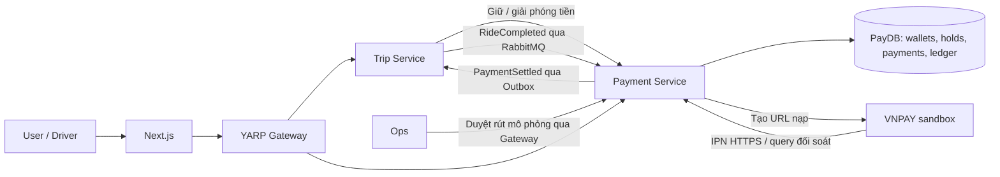

# Kế hoạch ví User/Driver và VNPAY sandbox

Ngày: 05/11/2026. Cập nhật 06/11/2026: mô-đun VNPAY sandbox, ví User/Driver, nạp tiền,
giữ tiền cho chuyến và rút mô phỏng đã có mã nguồn. Rút mô phỏng được ghi sổ khi Ops duyệt;
không chuyển tiền thật ra ngân hàng. Xem [VNPAY sandbox](vnpay-sandbox.md),
[ví/nạp tiền](wallet-topup.md) và [rút mô phỏng](wallet-withdrawals.md).

## 1. Phạm vi đã thống nhất

- User và Driver đều có ví. User nạp, thanh toán chuyến, xem lịch sử và yêu cầu rút.
- Driver nhận doanh thu chuyến thanh toán bằng ví, xem lịch sử và yêu cầu rút.
- VNPAY sandbox dùng để nạp ví. Các số dư trong bản demo là tiền mô phỏng.
- Rút tiền mô phỏng: chủ ví gửi yêu cầu, Ops duyệt hoặc từ chối, hệ thống ghi sổ.
- Giữ COD; thêm lựa chọn Ví SwiftRide khi đặt chuyến.
- Payment Service sở hữu toàn bộ ví, tiền giữ, nạp/rút, doanh thu và sổ cái trong PayDB.
  Không tách Wallet Service hoặc thêm database nghiệp vụ thứ tư.

Đề xuất cho bản đầu: chỉ User được nạp qua VNPAY; Driver có ví để nhận doanh thu và rút.
Nếu Driver cũng cần nạp, dùng lại luồng top-up và mở quyền sau khi có nhu cầu rõ ràng.
Không làm chuyển tiền giữa người dùng hay trả VNPAY trực tiếp cho từng chuyến ở bản đầu.

Các mặc định đề xuất, có thể đổi trước khi triển khai:

- VND nguyên đồng; chỉ số tiền dương cho nạp/rút. Cho phép chuyến miễn phí nếu giá server bằng 0.
- Nạp 10.000–5.000.000 VND/lần, kế thừa giới hạn hiện có; giới hạn rút cấu hình riêng.
- Phí nền tảng ban đầu 0%; vẫn lưu snapshot phí để có thể bật phí về sau.
- Doanh thu Driver có thời gian chờ khả dụng cấu hình được, ví dụ 60 giây cho demo.
- Hoàn toàn bộ một lần cho chuyến trả bằng ví, Ops phải nhập lý do; chưa làm hoàn một phần.
- Rút mô phỏng có phí 0; không gọi API ngân hàng và không yêu cầu thông tin ngân hàng thật.

## 2. Đánh giá mã hiện có

| Thành phần                                 | Hiện trạng                                          | Cách xử lý                                                             |
| ------------------------------------------ | --------------------------------------------------- | ---------------------------------------------------------------------- |
| COD                                        | Đang chạy, có ledger, idempotency, Outbox           | Giữ và chạy regression                                                 |
| `Wallet`                                   | Chỉ có `RiderId` và `Balance`                       | Mở rộng chủ ví, số dư khả dụng/giữ/chờ nhận                            |
| `WalletMethod`                             | Có trừ/hoàn số dư, chưa đăng ký runtime             | Đổi capture sang tiêu thụ khoản giữ của chuyến                         |
| `PaymentMethodFactory`                     | Registry DI, runtime chỉ `CashMethod`               | Thêm Wallet; bỏ điều kiện chặn cứng khác COD                           |
| `HostedPayments` cũ                        | Đã bỏ theo yêu cầu viết mới                         | Xây use case top-up mới sau khi hoàn tất thử merchant                  |
| `SandboxVnpay` mới                         | Checkout, HMAC, IPN và querydr                      | Tiếp tục nghiệm thu thanh toán với VNPAY sandbox thật                  |
| `SandboxStore`/`SandboxReconciliation` mới | Đã nối DI, có khóa, giới hạn lô và backoff          | Nối sổ cái khi triển khai top-up, không dùng giao dịch test để cộng ví |
| Payment API                                | COD và sandbox test riêng                           | Thêm API ví/top-up/rút và quyền tương ứng                              |
| Gateway                                    | Có route wallets và IPN sẵn                         | Kiểm tra policy, routing, rate limit riêng cho IPN                     |
| `PaymentView`                              | `RequiresCheckout=false`; `TripId=Id` mọi giao dịch | Phân loại top-up/trip, trả `TripId` nullable                           |
| Return page                                | Đọc trạng thái backend theo chủ sở hữu              | Giữ nguyên quy tắc không cộng tiền từ URL                              |
| UI thanh toán                              | COD và trang thử sandbox riêng                      | Thêm ví, nạp, rút, doanh thu và lịch sử tổng hợp                       |
| Driver                                     | ID đang gắn Payment qua nhánh COD                   | Ghi DriverId từ Trip cho mọi khoản thu chuyến                          |
| Rút tiền, giữ tiền, chia doanh thu         | Chưa có mô hình/use case                            | Xây mới trong Payment Service                                          |

Bằng chứng mã:
[DI](../backend/src/PaymentService/Infrastructure/Composition/ServiceRegistration.cs),
[Wallet](../backend/src/PaymentService/Domain/Wallet.cs),
[WalletMethod](../backend/src/PaymentService/Application/Methods/WalletMethod.cs),
[SandboxPayments](../backend/src/PaymentService/Application/Sandbox/SandboxPayments.cs),
[SandboxVnpay](../backend/src/PaymentService/Infrastructure/Sandbox/SandboxVnpay.cs),
[PaymentView](../backend/src/PaymentService/Application/ReadModels/PaymentView.cs),
[PaymentPanel](../frontend/src/features/rides/presentation/components/PaymentPanel.tsx).

Có mã cũ không có nghĩa chỉ thêm secret là dùng được. Chẳng hạn `PaymentCommands.Charge`,
`TripCommands.Create` và `RetryPayment` đều chặn phương thức ngoài COD. Worker cũ cũng chưa
có chính sách kết thúc đối soát đủ rõ để bật lại nguyên trạng.

## 3. Kiến trúc và các luồng tiền

### 3.1. Nạp ví

1. User nhập số tiền, gửi yêu cầu có `Idempotency-Key`.
2. Payment lấy chủ ví từ token, tạo TopUp và CheckoutAttempt trong transaction.
3. Backend ký URL VNPAY; frontend chuyển người dùng tới trang sandbox.
4. IPN tới backend: kiểm tra chữ ký, merchant, tham chiếu, số tiền, trạng thái.
5. Khóa operation/chủ ví; chuyển top-up sang Succeeded, cộng số dư và ghi ledger một lần.
6. Commit xong mới trả xác nhận IPN. Callback trùng không cộng lại.
7. Trang Return hỏi backend để hiển thị thành công/chờ xử lý/thất bại.
8. Nếu thiếu IPN, worker query kết quả; chỉ kết quả đã xác thực mới được ghi tiền.

Return URL không phải nguồn quyết định số dư. VNPAY phân biệt Return để hiển thị và
IPN để server cập nhật giao dịch. [Nguồn chính thức](https://sandbox.vnpayment.vn/apis/docs/faqs/).

Không coi đóng tab, hết thời gian trên giao diện, timeout hoặc query chưa tìm thấy giao dịch
là bằng chứng chắc chắn chưa trả tiền. Dùng trạng thái `Unknown/ReviewRequired` khi cần;
callback thành công tới muộn phải được xử lý hoặc chuyển đối soát rõ ràng, không bị bỏ qua.

### 3.2. Trả chuyến bằng ví

1. Chọn Wallet khi tạo chuyến; tiền và chủ ví không được lấy tùy ý từ client.
2. Khi User xác nhận báo giá, Trip lưu ý định giữ đúng số tiền/quote/version vào Saga.
3. Payment giữ tiền nguyên tử: chuyển Available sang Held theo `HoldId` của lần xác nhận.
4. Thiếu tiền: chưa mời Driver; hiển thị số tiền thiếu và cho nạp, sau đó xác nhận giá hợp lệ.
5. Giữ được tiền mới tiếp tục reservation tài xế và lời mời nhận chuyến.
6. Hủy, không có xe hoặc đổi báo giá: giải phóng đúng hold cũ; giá mới cần xác nhận và hold mới.
7. Trả khách: Trip phát RideCompleted. Payment kiểm tra hold còn Active, quote, chủ ví,
   TripId, DriverId và số tiền; capture hold, ghi doanh thu Driver/phí trong một transaction.
8. Payment phát PaymentSettled qua Outbox. Trip nhận hợp lệ mới chuyển Paid.
9. Doanh thu Driver ban đầu ở PendingIncoming; worker chuyển sang Available sau thời gian chờ.

Thêm trạng thái Saga phù hợp như `AuthorizingWallet`; không gọi provider trong transaction DB.
Mỗi lệnh giữ/giải phóng có operation ID ổn định, lưu ý định trước khi gọi mạng và retry hữu hạn.
Nếu timeout sau khi Payment đã giữ tiền, lần thử lại trả hold cũ, không giữ lần hai.

Quy tắc chống sự kiện đến sai thứ tự:

- `HoldId` gắn TripId + QuoteId/phiên bản; giải phóng cũ không đụng hold mới.
- Release tới trước Authorize phải lưu trạng thái kết thúc/tombstone cho HoldId đó,
  để Authorize tới muộn không làm sống lại khoản giữ đã hủy.
- Hold Captured không chuyển sang Released; hoàn sau capture là giao dịch refund riêng.
- Không tự giải phóng hold của chuyến đang chạy theo TTL ngắn. Worker đối soát dựa vào
  trạng thái Saga/chuyến có thẩm quyền; bất đồng hoặc mất mạng thì giữ để xử lý tiếp.
- Các bước giữ tiền, giữ tài xế và bồi thường có trạng thái bền vững để tiếp tục sau restart.

### 3.3. Doanh thu Driver và COD

Chuyến Wallet: User trả tổng giá; Driver nhận phần sau phí. Snapshot fee rate/fee amount
được chốt theo chính sách server và lưu cùng payment; đổi cấu hình không đổi chuyến cũ.
DriverAmount = TotalAmount - FeeAmount để không sai tổng do làm tròn.

Chuyến COD: Driver đã cầm tiền mặt, không cộng thêm số tiền đó vào ví có thể rút.
Hiển thị doanh thu tiền mặt và doanh thu ví riêng. Bản đầu chưa thu hoa hồng COD;
nếu cần thu sau này phải có sổ công nợ Driver riêng, không tự tạo số dư ví âm.

Ví dụ phí 0%: User nạp 200.000, giữ 60.000 cho chuyến, Available còn 140.000 và Held 60.000.
Trả khách: Held về 0; Driver có PendingIncoming 60.000. Sau thời gian chờ, Driver có
Available 60.000 để rút. Nếu bật phí 10%, Driver nhận 54.000 và nền tảng ghi 6.000.

### 3.4. Rút mô phỏng cho cả User và Driver

`Requested → Approved → Processing → Succeeded`

Nhánh kết thúc khác: `Rejected`, `Cancelled`, `Failed`; trạng thái không rõ là `ReviewRequired`.

1. Chủ ví nhập số tiền; hệ thống khóa ví và chuyển Available sang Held ngay khi tạo yêu cầu.
2. Ops xem, duyệt hoặc từ chối. Người tạo chỉ hủy khi còn Requested.
3. Duyệt chưa đồng nghĩa đã chi: tạo payout operation ổn định, giao cho adapter mô phỏng.
4. Simulator trả kết quả xác định theo operation ID; có thể kiểm thử success/failure/timeout.
5. Thành công: giảm Held, ghi ledger payout, lưu người duyệt và thời điểm xử lý.
6. Từ chối/hủy/thất bại chắc chắn: Held trở về Available đúng một lần.
7. Timeout/chưa biết: giữ tiền, query lại cùng payout ID hoặc Ops đối soát, không trả tiền
   về Available khi chưa biết chi đã thành công hay chưa.

Hai Ops bấm duyệt đồng thời hoặc worker restart không tạo hai payout. Ghi rõ
“Rút tiền mô phỏng” trên màn hình và biên nhận; không hiển thị đã chuyển ngân hàng thật.

VNPAY refund gắn với giao dịch thanh toán gốc và số tiền hoàn của giao dịch đó.
Không dùng nó thay cho chuyển tiền bất kỳ từ ví Driver/User sang ngân hàng.
[Tài liệu refund](https://sandbox.vnpayment.vn/apis/docs/truy-van-hoan-tien/querydr%26refund.html).

### 3.5. Hủy và hoàn tiền

- Hủy trước capture: release hold, chưa phải refund và không tạo doanh thu Driver.
- Hoàn chuyến Wallet trước khi doanh thu Driver khả dụng: khóa payment + các ví,
  đảo khoản Driver chờ nhận/phí và cộng lại User; phải nguyên tử với worker giải ngân.
- Nếu doanh thu đã khả dụng hoặc đã rút: đề xuất nền tảng chịu khoản hoàn bằng tài khoản
  RefundExpense; User nhận đủ tiền, không âm ví Driver. Ops phải thấy và xác nhận chính sách này.
- Hoàn chuyến COD: giữ luồng xác nhận đã hoàn tiền mặt hiện có; không cộng ví User.
- Mỗi chuyến chỉ hoàn toàn bộ một lần ở bản đầu; retry/gửi trùng không nhân đôi khoản hoàn.
- Chuyến đã thực hiện vẫn giữ Paid; Payment/biên nhận thể hiện Refunded và lý do.
- Hoàn về ví cho chuyến không phải hoàn khoản nạp qua VNPAY. Hoàn nạp về nguồn thẻ là
  phần mở rộng riêng, phải khóa phần tiền còn hoàn được và chống hoàn vượt tiền nạp.

## 4. Dữ liệu và sổ cái

### Các bảng/aggregate cần có hoặc mở rộng

| Thành phần            | Nội dung chính                                                          |
| --------------------- | ----------------------------------------------------------------------- |
| Wallet                | ID, OwnerSubject, Available, Held, PendingIncoming, version, trạng thái |
| WalletHold            | HoldId, WalletId, SourceType/SourceId, QuoteId, amount, trạng thái      |
| WalletOperation       | Loại nạp/chi/giữ/nhả/hoàn/rút, owner, key, request hash, trạng thái     |
| TopUp/CheckoutAttempt | OperationId, reference, merchant/environment, amount, provider result   |
| TripPayment           | TripId riêng, RiderId, DriverId, HoldId, fee snapshot, trạng thái       |
| DriverEarning         | PaymentId, amount, ReleaseAt, Pending/Available/Reversed                |
| Withdrawal            | WalletId, amount, hold, approval/version, payout ID, audit timestamps   |
| Journal               | OperationId/source rõ ràng; bút toán append-only, tổng Nợ = tổng Có     |

Một ví theo Keycloak subject; quyền User/Driver/Ops kiểm tra từ token và tài nguyên.
Không cho người gọi truyền `OwnerId` để thao tác thay ví khác. Không tạo ví Ops tiêu dùng
chung với tài khoản sổ cái nền tảng. Dữ liệu mới dùng OwnerSubject, không dùng tên RiderId cho Driver.

Các số dư là projection cập nhật cùng transaction với ledger. Có thể dựng lại/đối soát từ
ledger; không có endpoint sửa trực tiếp số dư. DB chặn số dư âm, số tiền sai và key trùng.
Tất cả luồng giữ/chi/rút/hoàn khóa ví theo cùng thứ tự để tránh deadlock và chi vượt số dư.

### Ví dụ bút toán

| Nghiệp vụ                           | Nợ                              | Có                              |
| ----------------------------------- | ------------------------------- | ------------------------------- |
| Nạp thành công                      | SandboxProviderClearing         | UserAvailable                   |
| Giữ tiền chuyến/rút                 | OwnerAvailable                  | OwnerHeld                       |
| Giải phóng giữ                      | OwnerHeld                       | OwnerAvailable                  |
| Thu chuyến ví                       | UserHeld                        | DriverPending + PlatformRevenue |
| Doanh thu đủ điều kiện rút          | DriverPending                   | DriverAvailable                 |
| Rút mô phỏng thành công             | OwnerHeld                       | SandboxPayoutClearing           |
| Hoàn trước giải ngân Driver         | DriverPending + PlatformRevenue | UserAvailable                   |
| Hoàn do nền tảng chịu sau giải ngân | RefundExpense                   | UserAvailable                   |

Đây là sổ mô phỏng demo; ProviderClearing không có nghĩa tiền thật đã vào ngân hàng merchant.
Mọi payment, hold, balance, journal và Outbox liên quan phải commit nguyên tử trong PayDB.
Không dùng transaction xuyên TripDB và PayDB; Saga xử lý lỗi giữa hai service.

## 5. API và giao diện đề xuất

| API                                      | Quyền       | Mục đích                                  |
| ---------------------------------------- | ----------- | ----------------------------------------- |
| GET /wallets/me                          | User/Driver | Tổng, khả dụng, giữ, chờ nhận             |
| GET /wallets/me/transactions             | User/Driver | Lịch sử phân trang, lọc loại/trạng thái   |
| POST /wallets/me/topups                  | User        | Tạo yêu cầu nạp, trả checkout URL         |
| GET /wallets/me/topups/{id}              | Chủ sở hữu  | Kết quả và trạng thái đối soát            |
| POST /wallets/me/withdrawals             | User/Driver | Giữ tiền và tạo yêu cầu rút               |
| POST /wallets/me/withdrawals/{id}/cancel | Chủ sở hữu  | Hủy khi Requested                         |
| GET /ops/withdrawals                     | Ops         | Danh sách và chi tiết yêu cầu             |
| POST /ops/withdrawals/{id}/approve       | Ops         | Duyệt với expectedVersion và key          |
| POST /ops/withdrawals/{id}/reject        | Ops         | Từ chối có lý do                          |
| POST /payments/{id}/refund               | Ops         | Hoàn đúng phương thức, có lý do           |
| GET /payments/vnpay/ipn                  | VNPAY       | Public callback, bắt buộc xác thực chữ ký |
| POST /internal/wallet-holds              | Service     | Giữ theo giá/snapshot Trip tin cậy        |
| POST /internal/wallet-holds/{id}/release | Service     | Giải phóng đúng hold                      |

Các lệnh ghi dùng Idempotency-Key và payload hash. Cùng key/khác payload trả conflict.
Không công khai đường internal qua proxy client; VNPAY IPN không yêu cầu JWT người dùng.
Gateway hiện định tuyến `/ops/**` sang Matching: cần route cụ thể `/ops/withdrawals/**`
sang Payment với ưu tiên cao hơn, tương tự các màn đối soát mới.

UI cần ba nhóm:

- User: ví/số dư/nạp/rút/lịch sử; lựa chọn COD/Wallet và số tiền thiếu khi xác nhận giá.
- Driver: thu nhập ví chờ nhận/khả dụng, rút mô phỏng, tiền mặt thu riêng, lịch sử chuyến.
- Ops: duyệt rút, hoàn chuyến, top-up chờ đối soát, ledger và audit người xử lý.

Return page đọc kết quả backend theo operation/reference và quyền sở hữu; không suy ra
đã nạp từ query string, không coi `PaymentId` nạp là `TripId` để mở chuyến không tồn tại.

## 6. Tích hợp VNPAY cần kiểm tra lại

Thông tin merchant: TmnCode, HashSecret, ReturnUrl và public HTTPS IPN đã đăng ký.
Lưu secret ở `.env` phía server; không đưa HashSecret vào `NEXT_PUBLIC_*`.
`setup.py` không tự sinh merchant credentials vì chúng do VNPAY cấp.

IPN cần truy cập được từ server VNPAY; `localhost` trên máy bạn không đáp ứng điều này.
Dùng tunnel HTTPS phục vụ đúng callback; giới hạn ingress vào đường IPN, không mở Keycloak,
database hoặc toàn bộ giao diện quản trị. Return URL theo cấu hình merchant và địa chỉ
trình duyệt truy cập được; nếu dùng domain mới thì kiểm tra cookie/OIDC redirect tương ứng.
[Hướng dẫn PAY chính thức](https://sandbox.vnpayment.vn/apis/docs/thanh-toan-pay/pay.html).

Checklist sửa adapter cũ trước khi bật:

1. Merchant/config thiếu phải lỗi rõ ở preflight; không che thành lỗi checksum người dùng.
2. Amount x100, GMT+7, canonical encoding và HMAC phải có fixture chuẩn của VNPAY.
3. IPN kiểm tra cả mã phản hồi và trạng thái thành công, reference, amount, merchant;
   reject tham số trùng/không hợp lệ. Provider transaction có unique constraint phù hợp.
4. ACK dùng đúng tên JSON `RspCode`/`Message`, không bị camelCase bởi mặc định ASP.NET.
   Phân biệt lần đầu, đã xử lý, sai chữ ký, sai tiền, không tìm thấy và lỗi hệ thống.
5. ACK thành công chỉ sau commit. Nếu callback và query chạy đồng thời, chỉ một bên ghi tiền.
6. Worker có batch size, NextAttemptAt, backoff/jitter, deadline đối soát và ReviewRequired.
   Không quét tất cả pending mãi mỗi 30 giây như mã cũ.
7. Không tự Decline chỉ vì query trả chưa tìm thấy sau 20 phút; phải xử lý khả năng đến muộn.
8. Chỉ tạo checkout attempt mới khi attempt cũ đã có kết quả cuối hoặc chính sách đối soát
   bảo đảm không thu trùng; tách retry mạng khỏi tạo giao dịch thu mới.
9. Không tự bật refund cũ: cờ RefundSubmitted lưu trước khi gửi có cửa sổ crash khiến request
   chưa từng được gửi. Dùng intent/job bền vững, request ID ổn định, query kết quả và xử lý Unknown.
10. Không log URL checkout/callback nguyên vẹn, signature/secret hoặc dữ liệu ngân hàng.

Không khẳng định query/refund của merchant sandbox đã được cấp đủ quyền. Kiểm tra sớm với
tài khoản thật của nhóm; nếu provider chưa phản hồi/cấp quyền, giữ trạng thái chờ đối soát,
không tự báo thành công. Refund về nguồn không nằm trên đường chạy demo cơ bản đã chọn.

## 7. Kế hoạch triển khai theo mốc nghiệm thu

### Mốc 0 — Khóa phạm vi và xác minh sandbox

- Chốt fee, thời gian chờ doanh thu, giới hạn nạp/rút và chính sách hoàn sau giải ngân.
- Đăng ký/lấy merchant sandbox, cấu hình Return/IPN, kiểm tra tunnel HTTPS.
- Kiểm tra một payment sandbox nhỏ: chữ ký, IPN/query và khả năng tái hiện callback.
- Sao lưu PayDB/TripDB trước migration; lưu điểm chuẩn luồng COD đang chạy.
- Đạt khi có bằng chứng callback hợp lệ hoặc xác định rõ hạn chế kết nối cần xử lý.

### Mốc 1 — Nền tảng ví và sổ cái

- Migration bổ sung WalletOwner, các bucket, operations, holds, earnings, withdrawals và audit.
- Tách operation ID khỏi TripId; sửa read model, ownership và pagination.
- Các use case credit/hold/release/capture có transaction, khóa và unique constraint.
- Đạt khi kiểm thử DB thật chứng minh không âm số dư và không chi trùng khi chạy đồng thời.

### Mốc 2 — Nạp VNPAY end-to-end

- Nối adapter/DI/config/API, thêm giao diện ví, tạo checkout và trang kết quả.
- IPN/query cập nhật top-up và ledger nguyên tử, thêm đối soát có giới hạn.
- Đạt khi thành công cộng đúng một lần, hủy không cộng, callback giả không cộng,
  đóng browser vẫn nhận tiền qua IPN, callback lặp hoặc đua với query không nhân đôi.

### Mốc 3 — Trả chuyến bằng ví và nhận doanh thu Driver

- Sửa Trip State/Saga để giữ tiền trước khi mời tài xế; giữ COD đi đường cũ.
- Capture khi trả khách; lưu DriverId, fee, earning và phát PaymentSettled.
- Worker giải ngân khoản Driver chờ nhận; thêm dashboard thu nhập.
- Đạt khi một chuyến chuyển tiền từ User sang Driver đúng một lần; hủy/tìm lại giải phóng
  đúng hold; hết tiền không mời Driver; restart không mất hold hoặc double capture.

### Mốc 4 — Rút mô phỏng và hoàn tiền

- API/UI User/Driver gửi rút; Ops duyệt/từ chối, audit, simulator có idempotency.
- Hoàn chuyến trước/sau giải ngân theo chính sách; chặn refund trùng và COD cộng nhầm ví.
- Đạt khi rút và trả chuyến đồng thời không vượt Available; Ops duyệt trùng không chi hai lần;
  từ chối giải phóng đúng tiền; Unknown vẫn giữ tiền; refund không làm âm Driver.

### Mốc 5 — Nghiệm thu và tài liệu bảo vệ

- Bổ sung runner PowerShell cho unit/integration/browser tests, tách test thuần và test sandbox.
- Kiểm thử lỗi broker, restart Payment, callback muộn/lặp/sai, đồng thời hai tab/hai Ops.
- Kiểm tra mobile, phân quyền, ledger đối soát lại balance và các cảnh báo trạng thái trung gian.
- Cập nhật README, sơ đồ Saga/sequence, requirements-review và acceptance bằng kết quả mới.
- Chỉ bật feature hoàn chỉnh sau khi test đạt; không đổi dữ liệu COD cũ thành Wallet.

Triển khai lần lượt; chưa cần ước lượng ngày trước khi biết khả năng nhận IPN và thời gian
nhóm dành cho đồ án. Mốc 1–3 là đường chạy chính; mốc 4 hoàn thiện yêu cầu rút đã thống nhất.

## 8. Migration, vận hành và giới hạn RAM

- Migration cộng thêm, giữ payment/journal lịch sử; phân loại `IsTopUp` và TripId nullable.
- Nếu Wallet cũ có Balance, đối soát ledger trước khi chuyển sang Available; không cộng tiền
  lại từ callback cũ hoặc tự sinh bút toán mở đầu khi ledger đã chứa khoản đó.
- Pending VNPAY cũ phải tách environment/merchant và rà soát; không cho worker mới tự xử lý
  bằng credentials sandbox khác. COD và giao dịch đã settled giữ nguyên kết quả.
- Mở rộng journal để tham chiếu operation nạp/rút/hold, không giả chúng là chuyến đi.
- Dừng container dự án trước build nặng; build từng image, kiểm thử nặng tuần tự.
- Không thêm Redis/service ví; worker nằm trong Payment, dùng PostgreSQL đã có.
- Chỉ bật observability khi xem trace/metric; dừng service bật riêng cho kiểm thử khi xong.
- Feature flags gợi ý: Wallet enabled, VNPAY top-up enabled, Simulated withdrawal enabled.
  Tắt nhận giao dịch mới vẫn phải cho đối soát/giải phóng giao dịch đang chạy tiếp tục.

## 9. Các ca bắt buộc trước khi coi là hoàn thành

1. Callback hợp lệ + callback trùng + query chạy đồng thời: chỉ một bút toán nạp.
2. Sai checksum/merchant/reference/amount, truy cập ví người khác: không đổi tiền.
3. Đóng tab và callback tới muộn: trạng thái cuối được cập nhật, không mất khoản nạp.
4. Hai lệnh rút, hoặc rút và giữ tiền chuyến cùng lúc: tổng chi không vượt Available.
5. User hủy sau giữ tiền; Driver từ chối và báo giá mới: không tồn dư hold cũ.
6. Release tới trước Authorize, timeout sau commit, retry sau restart: không giữ lại tiền đã hủy.
7. RideCompleted lặp, PaymentSettled lặp: một lần capture, một earning, Trip đóng đúng.
8. Hai Ops duyệt, payout timeout/restart: một lần chi; chưa rõ kết quả thì không trả hold.
9. Refund đua với giải ngân/rút Driver: chính sách thực hiện nguyên tử, không âm ví.
10. COD: Driver nhận tiền mặt, ví không tăng thêm; Wallet: không hiển thị nút xác nhận thu COD.
11. Chỉnh fee sau khi đã báo giá/capture: payment cũ giữ snapshot, tổng Nợ/Có luôn cân bằng.
12. Migration giữ dữ liệu; lịch sử nạp không tạo link sang chuyến giả; nhật ký không lộ secret.

## 10. Kịch bản demo cuối cùng

User nạp 200.000 qua VNPAY sandbox → đặt chuyến 60.000 bằng ví → Driver hoàn thành →
User còn 140.000, Driver nhận 60.000 theo mặc định phí 0 → doanh thu khả dụng →
Driver yêu cầu rút 40.000 → Ops duyệt → simulator thành công → Driver còn 20.000.

Demo thêm User rút tiền chưa dùng, Ops từ chối và trả hold; hủy chuyến giải phóng tiền;
hoàn tiền chuyến; callback/message gửi trùng không tạo tiền lần hai.

## Nguồn kỹ thuật chính thức

- [Kết nối PAY, cấu hình merchant, IPN và Return](https://sandbox.vnpayment.vn/apis/docs/thanh-toan-pay/pay.html).
- [FAQ: phân biệt Return/IPN và query/refund](https://sandbox.vnpayment.vn/apis/docs/faqs/).
- [Đặc tả querydr/refund](https://sandbox.vnpayment.vn/apis/docs/truy-van-hoan-tien/querydr%26refund.html).

Các quy tắc giữ tiền, phí, giải ngân Driver và rút mô phỏng là đề xuất thiết kế SwiftRide,
không phải chức năng ví do VNPAY Payment Gateway cung cấp.
